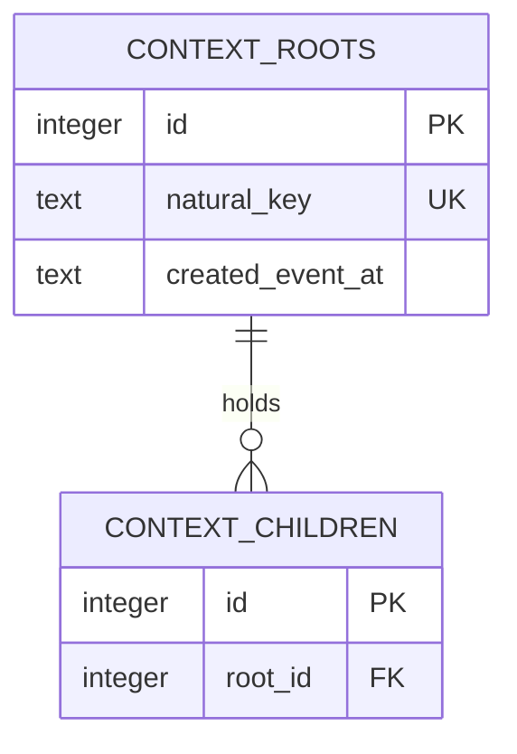

# Data model — <slug>

<!-- data-model-builder. Rules: .claude/rules/migrations.md. Inputs: PRD, SAD §5/§6/§8, ADR Stored data. -->

## Storage ledger

<!-- One row per table. Every column below must trace to a cell in this table. -->

| Table | Context | Root or child | ADR Stored data | Flow steps (quoted) | ACs |
|---|---|---|---|---|---|
| `<context>_<plural>` | <context> | root | [ADR NNNN](adr/...) | "<step text>" | AC-NN |

## ER diagram

## Tables

### `<context>_<plural>` (root of <aggregate>, migration `NNNN_create_<...>`)

| Column | Type | Constraints | Source |
|---|---|---|---|
| `id` | INTEGER | PK | rules |
| `<col>` | TEXT | NOT NULL, key | ADR NNNN Stored data |
| `<event>_at` | TEXT | NOT NULL | ISO 8601 UTC `Z`, app-set |

**Natural key:** `<columns, verbatim from SAD §8>`. **Lifecycle:** insert only | <how it changes>.

## Queries and indexes

<!-- Each query as SQL. The index that serves it. EXPLAIN QUERY PLAN result from roundtrip.py. -->

| Query (flow step) | SQL | Index | Plan |
|---|---|---|---|
| "<step text>" | `SELECT ... WHERE ...` | `UNIQUE (...)` or `idx_<table>_<purpose>` | SEARCH ... USING INDEX ... |

## Privacy check

<!-- Every column name against the person-field list; the allow-list ADR if one exists. -->

- Person fields: none (checked by `check_migrations.py`).
- Private names stored locally only: <team ids, issue keys, state names> (SAD §8 privacy ledger).

## Migrations

| File | Tables | Staged | Promoted |
|---|---|---|---|
| `NNNN_create_<...>` | `<tables>` | yes | <commit or "not yet"> |

## Checks

- `check_migrations.py`: <result line>
- `roundtrip.py`: <result lines>
- `make migrate` on a temp DB (after promote): <apply / no-op / revert / apply>

## Report

- Rules-file differences: <none | list>
- Drift: <skipped: no repo code yet | findings>
- Open questions: <list>
- Flags for the build: <list>
