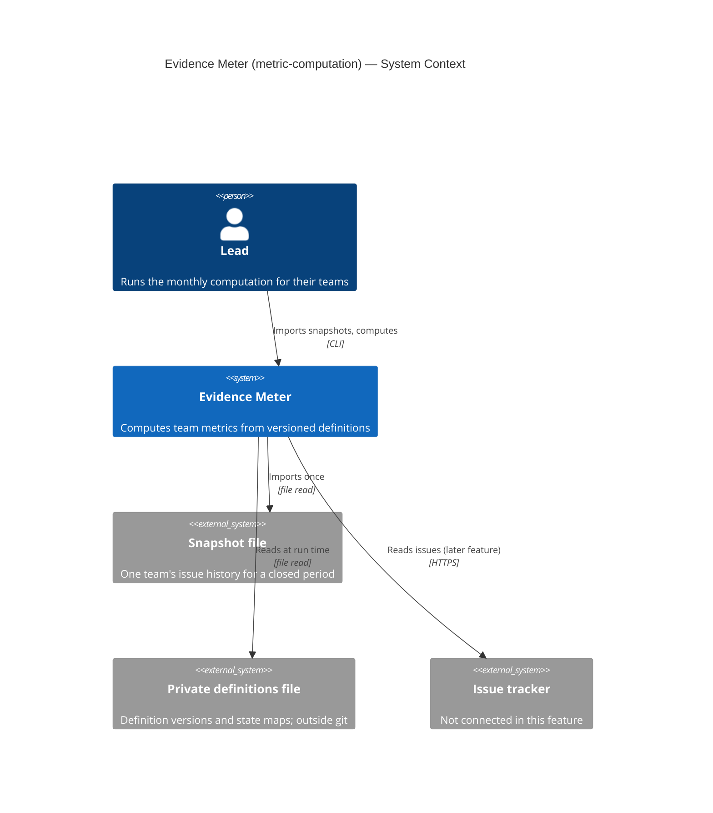
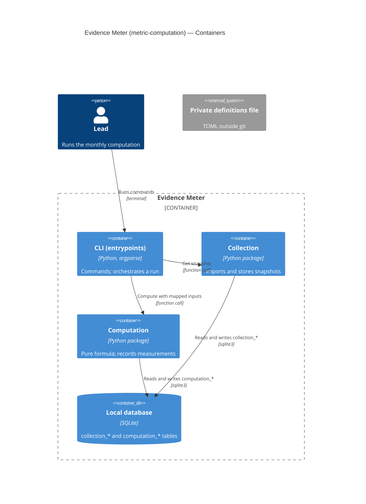
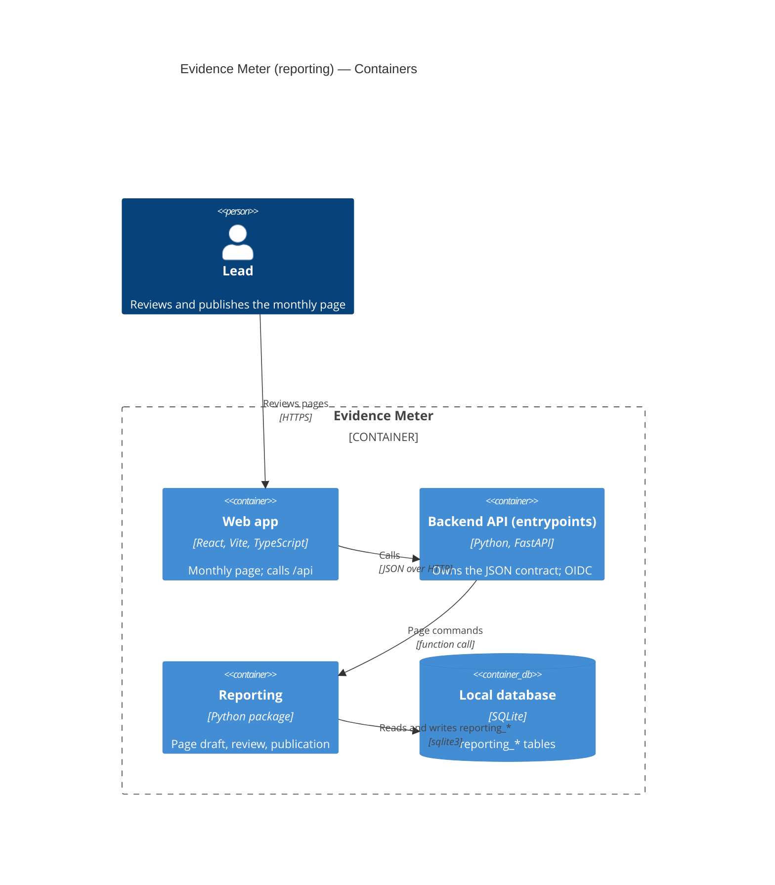

# C4 Mermaid syntax for §3 and §5

Ported from the plugin's cheatsheet, with examples from this repository. L1 Context goes in §3, L2 Container
in §5; L3 and L4 are out of scope.

## L1 — System Context (`C4Context`, §3)

The system as one box, its people and the external systems this feature touches. 4-8 elements.



Elements: `Person`, `Person_Ext`, `System`, `System_Ext`, `SystemDb`; `Rel(from, to, "what", "how")`.

Rules:
- Contexts (Collection, Computation, …) never appear in L1; they are L2.
- Use glossary role names (`Lead`), never `User` or `Admin`.
- A system the feature does not connect yet is drawn with "(later feature)" or left out; never implied.

## L2 — Container (`C4Container`, §5)

One process, so one `Container_Boundary`; context packages are containers because their boundaries are the
architecture. `shared` and `platform` are not drawn. Start from the recommended containers in
[repo-patterns.md](repo-patterns.md).



Elements: `Container_Boundary(id, "label") { … }`, `Container`, `ContainerDb`, `ContainerQueue` (none in this
repo yet); `Person` and `System_Ext` reused from L1.

Rules:
- One container per declared `target_surface` (CLI, API, web).
- No arrow from one context to another: wiring goes through `entrypoints` (dependency rule). If a diagram
  needs one, it is a bc-map question, not a drawing choice.
- Label every arrow with what and how (function call, sqlite3, HTTPS, file read).

## Two surfaces (CLI + API + web)



## Common mistakes

- `Container_Bondary` or `ContainerBoundary`: Mermaid draws an empty box without an error.
- A `Rel` to an element not declared above it.
- An arrow with no label or protocol.
- Mixing levels: a class or function inside an L2 diagram.

## Validating before commit

`mmdc` needs Chromium, which cannot start in the agent sandbox; CI runs `make diagrams`. In the session run
the structural lint, which catches the mistakes above for C4 and sequence diagrams:

```bash
python3 -I .claude/skills/sad-builder/scripts/lint_mermaid.py docs/features/<slug>/sad.md
```

Exit 0 means every block passed; otherwise it names the block and the problem. Say in the handoff that the
diagrams were linted, not rendered.
