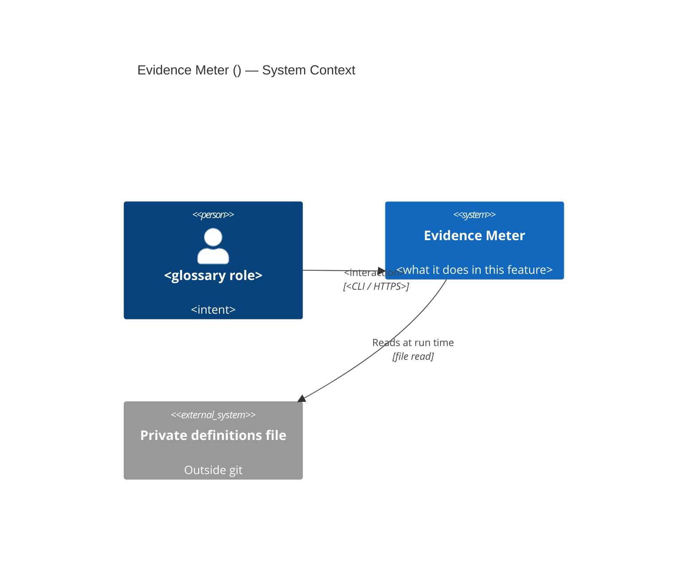
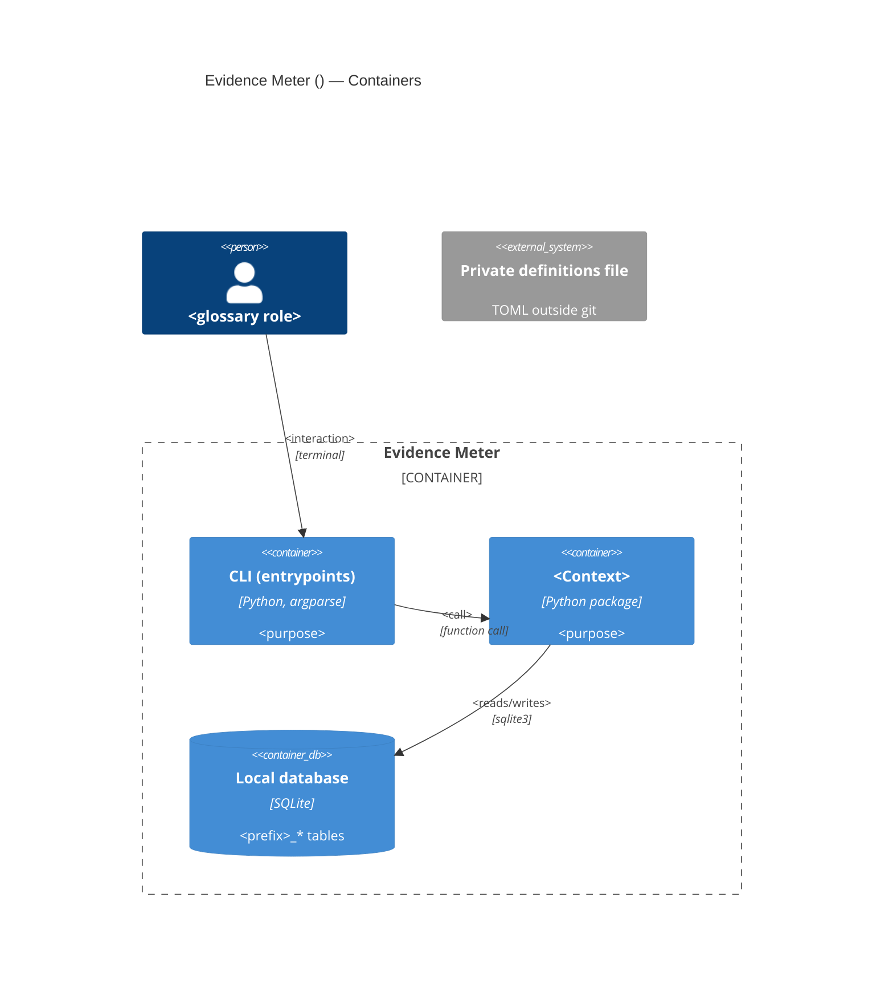
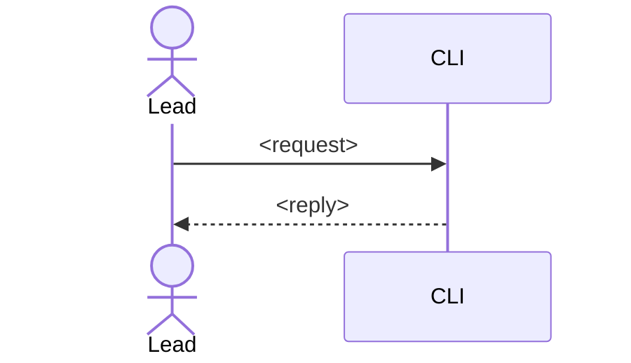

# Software Architecture Document — <slug> (F<n>)

<!-- sad-builder template. 12 Arc42 sections; an empty section is <!-- N/A: <reason> --> plus one visible  -->
<!-- sentence. C4 Context in §3, C4 Container in §5. §6 seeds flows; complete-sequence-diagrams adds the     -->
<!-- rest. §10 numbers verbatim from PRD §6. Every decision in the walk shows its gate score I M A D → n/4.  -->
<!-- Feature ADRs: "F<n> ADR NNNN"; repo-wide: "repo ADR NNNN".                                             -->

## 1. Introduction and goals

<!-- Intent: one paragraph from PRD §1-§2 — what, for whom, the committed approach.                       -->
<!-- Top-3 quality goals: from PRD §6 NFR + §6.1; the other NFRs named in one line as "§10 too".          -->
<!-- Stakeholders: glossary roles first (CONTEXT.md), then PRD reviewers; sign-off = PRD reviewers.        -->

**Intent.** <one paragraph>

**Top-3 quality goals (scenarios in §10):**

1. **<goal>** — <one line, the NFR it comes from>.
2. **<goal>** — <…>.
3. **<goal>** — <…>.

<Other NFRs that get §10 scenarios but do not override the three.>

**Stakeholders.**

| Role | Interest | Sign-off owner? |
|---|---|---|
| <glossary role> | <…> | No |
| Tech Lead | Approves this SAD | Yes |
| Security Lead | <why a review is needed, from PRD §6.1> | Yes |

<!-- Decision overrides — added by the critic resolution: "<headline> — overridden, rationale: <…>". -->

## 2. Constraints

<!-- Inputs, not choices. Cite the source of each line (AGENTS.md, repo ADR, architecture-map).           -->

**Technical.**
- Python 3.12 with uv; standard library first; a new dependency needs the owner's OK (AGENTS.md).
- SQLite via `sqlite3`; migrations `NNNN_<name>.up/.down.sql` by `platform/migrate.py` (repo ADR 0003).
- Modular monolith, dependency rule in `tests/test_architecture.py` (repo ADR 0002).
- <surface-specific: argparse CLI / FastAPI on 127.0.0.1 until OIDC (repo ADR 0004) / React + Vite web>

**Organisational.**
- <team, delivery window from the plan>

**Conventions.**
- AGENTS.md, ARCHITECTURE.md, bc-map, architecture-map; failing test first; golden data by hand.

**Regulatory / external.**
- Public repository: synthetic data only; private definitions outside git, read only by Definitions.
- Team-level only; <PRD §6.1 personal data note>.

## 3. Context and scope

<!-- 2-3 sentences: what the system does for whom in this feature, and the trust boundary.               -->
<!-- External systems from the recommended list (repo-patterns): definitions file, snapshot file,       -->
<!-- tracker, Git hosting. Systems not connected in this feature are drawn with "(later feature)".      -->

<context in 2-3 sentences; trust boundary in one>

**External systems (in / out):**

| Actor or system | Type | Interaction |
|---|---|---|
| <glossary role> | Person | <…> |
| Private definitions file | External file outside git | <…> |

**C4 Context (L1):**



## 4. Solution strategy

<!-- Decision 1: target surface(s) → frontmatter. A data-serving surface: check repo ADR 0004 in the     -->
<!-- same question. A UI surface: one UI-architecture decision that reuses map §Frontend.               -->
<!-- Then 3-5 strategic choices, each with its gate score and its F<n> ADR link.                        -->

**Target surface(s):** `<[cli]>` — <why; ADR link>.

**Strategic choices:**

1. **<choice>** — <2-3 sentences; quality goal it serves> ([F<n> ADR NNNN](adr/NNNN-<context>-<decision>.md)).
2. **<choice>** — <…>.
3. **<choice>** — <…>.

Later tactical decisions trace to one of these; a contradiction is a §11 risk.

## 5. Building block view

<!-- Style paragraph: modular monolith, layers per context. Start from the recommended containers.       -->

<one paragraph>

**Context touch list:**

<!-- Added by sad-builder: AGENTS.md asks to say when a change crosses parts. One row per part touched. -->

| Part | Changes | Tables (prefix) | Events published / consumed |
|---|---|---|---|
| <context or shared / platform / entrypoints> | <new or changed modules> | <collection_*> | <event names> |
| Evidence Guard, Reporting | not touched | — | — |

**Internal decomposition:**

```
src/evidence_meter/
├── <context>/<layer>/   <responsibility>
└── entrypoints/          <commands / routes>
```

**C4 Container (L2):**



## 6. Runtime view

<!-- Seed 1-2 flows: the happy path and the flow with the most refusal branches. Participants are the     -->
<!-- §5 container names. Every alt/else branch ends with its own reply to the actor.                    -->

**Critical flow 1: <name> (<ACs>)**



**Event ledger:**

<!-- Added by sad-builder. Every bc-map event of a touched context: produced, consumed, or debt (§11). -->

| Event | bc-map owner | In this feature |
|---|---|---|
| <EventName> | <context> | <published by … / consumed by … / not yet: §11 debt> |

## 7. Deployment view

<!-- CLI-only feature: deliberate N/A with one visible sentence and a capacity note.                    -->
<!-- A data-serving surface: where it binds, sign-in, and the numbers at which something changes.      -->

<!-- N/A: <reason> -->

<one sentence where it runs; capacity note>

## 8. Crosscutting concepts

| Concept | Convention | Where defined |
|---|---|---|
| Logging | <stderr, no person fields, where private names may appear> | <here / AGENTS.md> |
| Authentication | <none until a data-serving surface / OIDC per repo ADR 0004> | <ADR> |
| Capability rule | Team-level only; <how a person breakdown is refused> | AGENTS.md |
| Refusal codes | <closed list: code → PRD AC> | <F<n> ADR> |
| ID strategy | <identity of each stored record; every input in it or stored with it> | <F<n> ADR> |
| Time and period | <timezone of stored timestamps; period rule> | <F<n> ADR> |
| Transactions | <one transaction per write command; checks before the first write> | here |
| Events | <shared/events.py; dispatcher in entrypoints> | <ADR> |
| Privacy ledger | <every place person data / private names could land: never, or only here and why> | <ADR> |
| Offline | <network only in Collection adapters; test> | PRD §6 |
| Configuration | <env vars in platform/config.py> | here |
| Internationalisation | English only | — |

## 9. Architecture decisions

| # | Title | Owning context | Gate | Status | Section |
|---|---|---|---|---|---|
| [NNNN](adr/NNNN-<context>-<decision>.md) | <imperative title> | <context> | <n>/4 | Accepted | §<n> |

Feature ADRs live in `adr/`; repo-wide ones in `docs/adr/` ("repo ADR NNNN").

## 10. Quality requirements

<!-- One scenario per §1 goal plus the other NFRs. Then = PRD §6 target verbatim. How verify = the PRD's -->
<!-- measurement plus a proposed test file name (plan-tests confirms). The all-or-nothing scenario names -->
<!-- every refusal AC.                                                                                  -->

**QG-1. <goal>**
- **When:** <trigger>
- **Then:** <PRD §6 target verbatim>
- **How verify:** <PRD measurement> (`tests/<file>.py`)

## 11. Risks and technical debt

| Risk / debt | Severity | Mitigation | Owner |
|---|---|---|---|
| <risk from an ADR's negative consequence, PRD §8 or the map> | <Low/Medium/High> | <…> | <owner> |
| Open architectural decision: <headline> | Open question | Resolve before <stage or date>; <reason> | <owner> |

**Accepted debt:**
- <bc-map events not produced yet (from the event ledger)>
- <brownfield gaps from the map this feature does not fix>

## 12. Glossary

<!-- CONTEXT.md terms used in this SAD, verbatim; new terms marked *new* for /sdlc:fix-term.            -->

| Term | Meaning |
|---|---|
| <term> | <meaning> |
