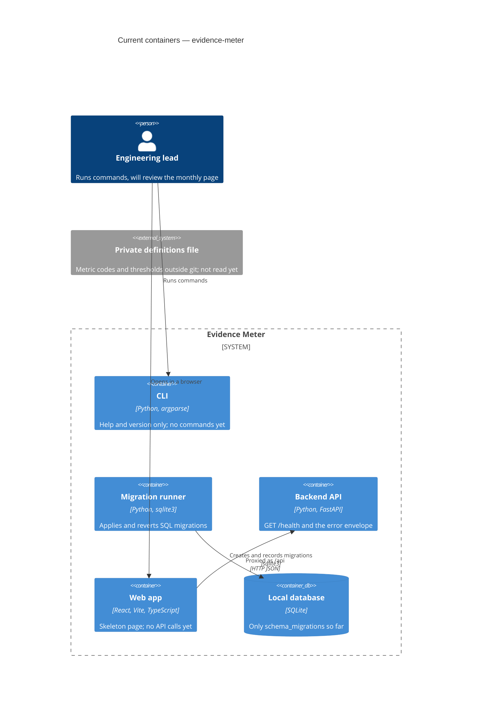

# Architecture map — evidence-meter

> The **current** architecture (what exists today), produced by `map-architecture` and read by
> write-prd, architecture-design, generate-data-model and implement-tasks. Refresh with
> `/sdlc:map-architecture` when the repo drifts past `reflects_commit`. Contexts, glossary and structure
> per context come from [bc-map.md](bc-map.md), which stays the source for boundaries.
>
> **State in one line:** the scaffold is health-only. Every context is an empty package with its layer
> subpackages; there is no feature code, no shared kernel types, no events and no tables yet. The real
> code is the CLI and API shells, the migration runner, the dependency-rule test and a skeleton web page.

## Stack

- Language / runtime: Python >=3.12 with uv, build backend `uv_build` (`pyproject.toml:6`, `:15-17`);
  Node 22 for `web/` only (`.github/workflows/check.yml`).
- Backend: FastAPI 0.165, uvicorn 0.54, bound to 127.0.0.1 (`pyproject.toml:7-10`, `Makefile:19`,
  [ADR 0001](adr/0001-stack.md)).
- CLI: argparse, script `evidence-meter = evidence_meter.entrypoints.cli:main` (`pyproject.toml:12-13`).
- Datastore: SQLite through the standard `sqlite3` module ([ADR 0003](adr/0003-persistence-sqlite.md)).
- Dev: pytest 9.2, ruff 0.17 (line 100, rules E/F/W/I/B/UP/SIM), httpx2 2.16 for the FastAPI test
  client (`pyproject.toml:19-36`).
- Web: React 19, Vite 8, TypeScript 7, Vitest 5, oxlint 1.90, mermaid-cli 12 (`web/package.json:14-28`).
- Build / test / lint: `make sync`, `make dev`, `make test` (pytest + Vitest), `make lint` (ruff check,
  ruff format check, `tests/test_architecture.py`, oxlint, `tsc -b`), `make migrate`, `make diagrams`,
  `make check` = lint + test (`Makefile:1-56`). CI `.github/workflows/check.yml` runs `make sync`,
  `make check`, `make diagrams` on push to main and on pull requests.

## C4 — system as it is

The issue tracker and Git hosting are not connected yet; Collection has no adapter.

## Module inventory

| Module | Path | Layers (present) | Wired at | Code today |
|---|---|---|---|---|
| Collection | `src/evidence_meter/collection/` | handler/service/repo | not wired | none (`__init__.py` + README) |
| Definitions | `src/evidence_meter/definitions/` | handler/service/repo | not wired | none |
| Computation | `src/evidence_meter/computation/` | domain/app/infra | not wired | none |
| Evidence Guard | `src/evidence_meter/evidence_guard/` | handler/service/repo | not wired | none |
| Reporting | `src/evidence_meter/reporting/` | handler/service/repo | not wired | none |
| Shared kernel | `src/evidence_meter/shared/` | flat | — | docstring only; `Team`, `Period`, events not defined (`shared/__init__.py:1`) |
| Platform | `src/evidence_meter/platform/` | flat | `Makefile:40-41` | `migrate.py` only; no config module, no shared connection helper |
| Entrypoints | `src/evidence_meter/entrypoints/` | flat | `pyproject.toml:12-13` | `cli.py` (empty subcommand group), `api.py` (health + envelope); no dispatcher |
| Web | `web/` | Vite app | `web/package.json` | `App.tsx` skeleton, one Vitest test |

## Conventions (cited — the rules a new feature must match)

- **Dependency rule:** a context imports only itself, `shared` and `platform`; layers point inward
  (handler → service → repo, infra → app → domain); Computation `domain` imports only the standard
  library and `shared`. Checked by an `ast` walk over every file in `src/`
  (`tests/test_architecture.py:20-26`, `:44-72`, `:133-135`), with a self-test of the checker (`:80-115`);
  runs in `make lint` (`Makefile:32`).
- **Module wiring:** only `entrypoints/` may import contexts. CLI subcommands hang off the subparsers group
  in `build_parser()` (`entrypoints/cli.py:11-18`); routes are added to `app` (`entrypoints/api.py:9`).
- **Inter-module communication:** events named in bc-map, dispatched by `entrypoints`. Not built: no event
  types, no dispatcher. The first feature that crosses contexts defines both.
- **Error handling:** API errors leave as `{"error": {"code", "message"}}` through one `HTTPException`
  handler (`entrypoints/api.py:12-17`). Validation errors and unhandled exceptions are not mapped yet.
  A refused value is a `Verdict` (a result, not an exception); not built.
- **IDs:** UNKNOWN. No ID strategy in code; the only key is `schema_migrations.name`. Decided with the
  first data model (F1, S7).
- **Configuration:** the only env var read is `EVIDENCE_METER_DB`, default `var/evidence-meter.sqlite3`
  (`platform/migrate.py:13`, `:86`). No central settings object.
- **Persistence / DB access:** each context will own its tables behind its `repo`/`infra` layer; today the
  only connection code is `_connect()` in `platform/migrate.py:21-25` (autocommit, creates parent dir).
- **Migrations:** `migrations/NNNN_<lower_snake>.up.sql` + `.down.sql`, name checked by regex
  `\d{4}_[a-z0-9_]+` (`platform/migrate.py:15`, `:42-47`); each script plus its record in one
  `BEGIN…COMMIT`, rollback on error (`:32-39`); `revert_last()` runs the newest `.down.sql` (`:65-77`).
  Only `0001_init` (no-op `SELECT 1`) exists. This is the convention `generate-data-model` must follow.
- **Tests:** pytest under `tests/`, one file per concern; integration on a temp SQLite file
  (`tests/test_migrate.py:28-61`), API through the FastAPI test client (`tests/test_entrypoints.py:10-28`).
  Harness controls are pinned by `test_permissions.py`, `test_sandbox.py`, `test_rules.py`,
  `test_commands.py`, `test_instructions.py`. Every metric gets golden data with hand-computed values
  (AGENTS.md).
- **Data:** synthetic and public only; team-level outputs only, never per person (AGENTS.md).
- **UI / styling:** plain CSS with custom properties and a dark-mode block (`web/src/index.css:2-16`,
  `:35-41`); see §Frontend.

## Datastores

| Store | Engine | Accessed via | Notes |
|---|---|---|---|
| Local database | SQLite file (`EVIDENCE_METER_DB`, default `var/evidence-meter.sqlite3`) | `platform/migrate.py` only, so far | `var/` is gitignored; tables: `schema_migrations(name, applied_at)` only |

## Frontend / UI foundation

- **Component library / design system:** none; run `/sdlc:design-system` before the first UI feature — `web/src/`
- **Design tokens:** CSS custom properties from the Vite template, light and dark — `web/src/index.css:2-16`, `:35-41`
- **Styling approach:** one global plain CSS file, no modules or Tailwind — `web/src/index.css`
- **Shared primitives:** none
- **State / data-fetching:** none; the dev server proxies `/api` to `127.0.0.1:8000` and strips the prefix — `web/vite.config.ts:5-13`
- **Closest UI precedent:** `web/src/App.tsx:2-9` (heading only), tested by `web/src/App.test.tsx:5-8`

## Where things live / closest precedents

- A new metric → formula in `computation/domain/`, golden data in `tests/`, definition shape in
  `definitions/`; no precedent yet.
- A new data source → an adapter in `collection/repo/`; no precedent yet.
- A new CLI command → a subparser in `entrypoints/cli.py:11-18`, calling a context handler; the closest
  shape today is `platform/migrate.py:80-91` (argparse, env var, one result line).
- A new route → `entrypoints/api.py`, modelled on `/health` (`:20-22`); errors through the envelope.
- A new table → a migration pair in `migrations/`, tested like `tests/test_migrate.py`.
- A new screen → `web/src/`, composed from the design system once it exists.

## Constraints & known tech-debt

- Auth is deferred: OIDC with the first feature that serves data; until then the API and web dev server
  bind to 127.0.0.1 only ([ADR 0004](adr/0004-auth-oidc-deferred.md)).
- `ReportingPeriodClosed` has no owner context; it is an external trigger (CLI or scheduler).
- The API envelope covers `HTTPException` only; a validation error or crash returns FastAPI's default
  body. Fix before the first data route.
- `migrate.py` interpolates migration names into SQL; `apply()` is guarded by the name regex, but
  `revert_last()` reads the name back from the table without re-checking it.
- No shared SQLite connection helper or settings module; the first feature needs one in `platform/`.
- No MCP server surface; decided in the first SAD.

## Reconciliation with the authored architecture doc

`docs/bc-map.md` is authoritative for contexts, events, glossary and structure per context; this map
takes them unchanged and marks which parts are not built. `ARCHITECTURE.md` (imported by `AGENTS.md`)
matches this map on layout, dependency rule and events; its event table describes the design, not code
that exists. `AGENTS.md` is authoritative for commands, data rules and commits. The previous version of
this map (greenfield-bootstrap, `cd34458`) described the target; the scaffold built it as listed above,
with two recorded deviations: oxlint instead of ESLint and httpx2 instead of httpx.
