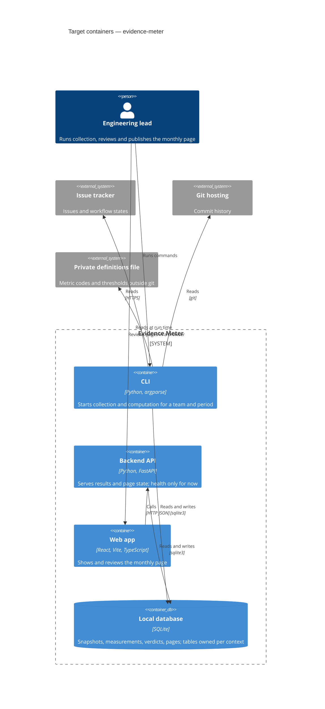

# Architecture map — evidence-meter

> The **target foundation** fixed by `map-architecture` in greenfield mode: what the scaffold builds and
> every feature follows. Read by write-prd, architecture-design, generate-data-model and implement-tasks.
> Contexts, glossary and structure per context come from [bc-map.md](bc-map.md), which stays the source
> for boundaries. Refresh with `/sdlc:map-architecture` once the scaffold exists (mode becomes `current`).

## Stack

- Language / runtime: Python 3.12 with uv (`pyproject.toml`, `.python-version`); Node 22 for `web/` only.
- Backend: FastAPI served by uvicorn, bound to 127.0.0.1 ([ADR 0001](adr/0001-stack.md)).
- CLI: argparse (standard library), script `evidence-meter`.
- Datastore: SQLite through the standard `sqlite3` module, plain SQL migrations
  ([ADR 0003](adr/0003-persistence-sqlite.md)).
- Web: React + Vite + TypeScript in `web/`, Vitest, ESLint.
- Build / test / lint: `make sync`, `make dev`, `make test`, `make lint`, `make migrate`, `make check`
  (= lint + test, the proving command). CI runs `make sync` + `make check`.

## C4 — target containers

## Module inventory (target)

| Module | Path | Layers | Wired at | Responsibility |
|---|---|---|---|---|
| Collection | `src/evidence_meter/collection/` | handler/service/repo | `entrypoints/` | Immutable snapshot of tracker and Git data per team and period |
| Definitions | `src/evidence_meter/definitions/` | handler/service/repo | `entrypoints/` | Versioned metric definitions loaded from the private file |
| Computation | `src/evidence_meter/computation/` | domain/app/infra | `entrypoints/` | Applies a definition version to a snapshot; pure domain |
| Evidence Guard | `src/evidence_meter/evidence_guard/` | handler/service/repo | `entrypoints/` | Verdict per value: accepted or refused with a reason |
| Reporting | `src/evidence_meter/reporting/` | handler/service/repo | `entrypoints/` | Monthly page per team: draft, review, publication |
| Shared kernel | `src/evidence_meter/shared/` | flat | — | `Team`, `Period`, event types; no logic of any context |
| Platform | `src/evidence_meter/platform/` | flat | — | Technical helpers: config from env, SQLite connection, migration runner |
| Entrypoints | `src/evidence_meter/entrypoints/` | flat | `pyproject.toml` scripts | CLI and FastAPI app; the only place that wires contexts together |
| Web | `web/` | Vite app | `web/package.json` | Browser UI over the backend API |

## Conventions

- **Dependency rule:** a context imports only `shared`, `platform` and itself; never another context or
  `entrypoints`. `shared` and `platform` import no context. Inside a context: handler → service → repo;
  Computation `domain` imports only the standard library and `shared`. Checked by
  `tests/test_architecture.py`, run by `make lint`.
- **Inter-module communication:** through events named in bc-map (`MetricComputed`, `ValueRefused`, …),
  dispatched by `entrypoints`; no context calls another.
- **Error handling:** a refused value is a `Verdict`, a result, never an exception. The API returns errors
  as `{"error": {"code": "...", "message": "..."}}`.
- **IDs:** UNKNOWN, decided with the data model (S7).
- **Persistence / DB access:** each context owns its tables behind a repository in its `repo`/`infra`
  layer; no cross-context table access.
- **Migrations:** `migrations/NNNN_<name>.up.sql` + `NNNN_<name>.down.sql`, applied in order by
  `platform/migrate.py`, recorded in `schema_migrations`; `make migrate`.
- **Tests:** pytest; unit tests without I/O, integration tests on a temp SQLite file (no container);
  every metric gets golden data with hand-computed expected values. Web: Vitest.
- **Data:** synthetic and public only; team-level outputs only, never per person (CLAUDE.md).
- **UI / styling:** the Vite template's plain CSS until a design system is chosen.

## Datastores

| Store | Engine | Accessed via | Notes |
|---|---|---|---|
| Local database | SQLite file (`EVIDENCE_METER_DB`, default `var/evidence-meter.sqlite3`) | `platform` connection, per-context repositories | `var/` is gitignored |

## Frontend / UI foundation

- **Component library / design system:** none yet; set it with `/sdlc:design-system` before the first UI
  feature — `web/src/`
- **Design tokens:** UNKNOWN (none yet)
- **Styling approach:** plain CSS from the Vite template — `web/src/index.css`
- **Shared primitives:** none yet
- **State / data-fetching:** UNKNOWN (none yet; plain `fetch` to the backend until a feature needs more)
- **Closest UI precedent:** `web/src/App.tsx` (template app)

## Where things live / closest precedents

- A new metric → formula in `computation/domain/`, golden data in `tests/`, definition shape in
  `definitions/`; no precedent yet.
- A new data source → an adapter module in `collection/repo/`; no precedent yet.
- A new CLI command or route → `entrypoints/cli.py` or `entrypoints/api.py`, calling a context handler.
- A new screen → `web/src/`, composed from the design system once it exists.

## Constraints & known tech-debt

- Auth is deferred: OIDC with the provider from env, implemented with the first feature that serves data;
  until then the API binds to 127.0.0.1 only ([ADR 0004](adr/0004-auth-oidc-deferred.md)).
- `ReportingPeriodClosed` has no owner context; it is an external trigger (CLI or scheduler).
- No MCP server surface yet; decided in the first SAD.

## Reconciliation with the authored architecture doc

`docs/bc-map.md` is authoritative for contexts, events, glossary and structure per context; this map
takes them unchanged. `CLAUDE.md` is authoritative for commands, data rules and commits. No
`ARCHITECTURE.md` existed before this map; the scaffold adds a short one that points here.
