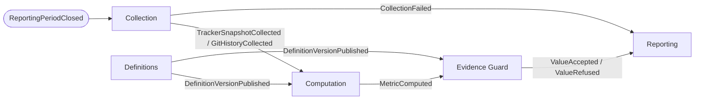

# Bounded context map

Where the boundaries of Evidence Meter run before there is a folder structure. Built from the idea in the
README (no code exists yet), by Event Storming lite: events in the past tense, grouped by who is
responsible, a boundary wherever one part only tells another that something happened. The scaffold (S5)
takes its modules from this file. All names below are generic; an organisation's own metric codes and
identifiers stay in the private definitions file.

## Polysemy test: "status"

One word, three meanings with different fields:

| Where | Meaning | Fields |
|---|---|---|
| Issue tracker data | the workflow state of an issue | state name (`In Progress`, `Done`), category, changed-at timestamp |
| A computed metric | whether a value may be shown | computed or refused, refusal reason, data coverage |
| The monthly page | where the draft is in review | drafted, reviewed, published, reviewer note |

Decision: rename it in each context instead of sharing one `status` type: `IssueState` in Collection,
`Verdict` in Evidence Guard, `PageState` in Reporting. The three never meet in one object, so each
context gets its own word.

## Events

| # | Event | Context |
|---|---|---|
| 1 | `TrackerSnapshotCollected` | Collection |
| 2 | `GitHistoryCollected` | Collection |
| 3 | `CollectionFailed` | Collection |
| 4 | `DefinitionVersionPublished` | Definitions |
| 5 | `MetricComputed` | Computation |
| 6 | `ValueAccepted` | Evidence Guard |
| 7 | `ValueRefused` | Evidence Guard |
| 8 | `PageDrafted` | Reporting |
| 9 | `PageReviewed` | Reporting |
| 10 | `PagePublished` | Reporting |
| 11 | `ReportingPeriodClosed` | not assigned (see below) |

## Contexts

- **Collection**: reads the issue tracker and Git for one team and one period and keeps an immutable
  snapshot. It knows trackers, fields and commits; it knows nothing about metrics.
- **Definitions**: the versioned catalogue of metric definitions (formula id, inputs, minimum data,
  version). It loads the private definitions file at run time and never writes it.
- **Computation**: applies one definition version to one snapshot and produces a raw value with the inputs
  it used. Pure functions; no I/O of its own.
- **Evidence Guard**: decides whether a computed value may be shown: enough data, enough coverage, no
  per-person breakdown. Its output is a verdict with a reason, so a refused value is a result, not an error.
- **Reporting**: turns accepted values and refusals into a monthly page per team, keeps the draft, the
  review and the publication.

Not a context: **Store**. It was a candidate, but it has no words of its own; it persists what the other
contexts own. Each context keeps its own tables behind a repository in its infra.

### Event not assigned: `ReportingPeriodClosed`

Nobody inside the tool owns it. The month ends by the calendar or by a person deciding the data is final;
Collection needs it to know when to take the last snapshot, Reporting to know when to draft. Assigning it
to either would make the other depend on it. For now it is an external trigger (the CLI command or a
scheduler) that starts Collection; revisit if periods ever need reopening.

## Glossary

| Context | Terms |
|---|---|
| Collection | Source (tracker or Git), Snapshot, Issue, IssueState, Commit |
| Definitions | MetricDefinition, DefinitionVersion, Formula, MinimumData |
| Computation | Measurement (raw value plus inputs), Period, Team |
| Evidence Guard | Verdict, RefusalReason, Coverage, Threshold |
| Reporting | MonthlyPage, PageState, Review, Publication |

`Team` and `Period` are shared identifiers (a value, not an entity) passed in every event; no context owns
their lifecycle.

## Map

Dependency rule: arrows point downstream only. Reporting never calls Computation, Computation never
reads a tracker, and nothing but Definitions reads the private definitions file.

## Structure per context

Thresholds from the lesson: up to 3 entities flat, 3 to 10 feature-first, hexagonal when the domain is
complex and two or more people change it. One person builds this, so the people axis says simple for all.

| Context | Entities | Structure now | Why |
|---|---|---|---|
| Collection | Snapshot, Issue, Commit | handler/service/repo | few entities; the complexity is in the source adapters, which are plain modules |
| Definitions | MetricDefinition, DefinitionVersion | handler/service/repo | two entities, mostly loading and validating a file |
| Computation | Measurement | domain/app/infra | one entity, but the formulas are the core and must be tested without I/O; a pure `domain` makes golden-data tests the whole proof |
| Evidence Guard | Verdict | handler/service/repo | one entity, rules are small; move to domain/app/infra if rules grow |
| Reporting | MonthlyPage, Review | handler/service/repo | page state and a template; no complex rules |

Code is split by context from the start (modular monolith, one package per context under
`src/evidence_meter/`), even where a context is small, because the boundary is the decision that is costly
to change later.

## Decisions and disagreements

Drafted with Claude on 2026-11-22; the owner reviewed each boundary choice the same day.

- Store dropped as a context: accepted. Persistence lives in each context's infra.
- Evidence Guard kept apart from Computation: accepted. Refusal rules change apart from formulas, and the
  refusal is the product's main promise; merging would let rules leak into formulas.
- `ReportingPeriodClosed` left as an external trigger: accepted.
- `status` renamed per context and domain/app/infra for Computation only: accepted.
- Rejected from Claude's proposal: nothing this round.
