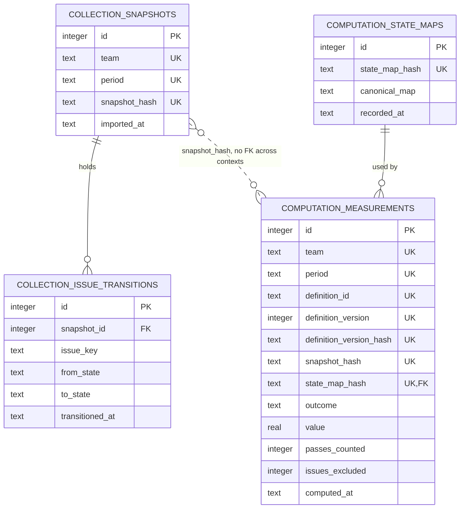

# Data model — metric-computation (F1)

<!-- Generated by sdlc generate-data-model (m06-l05), adapted to SQLite and the stdlib runner per
.claude/rules/migrations.md. Migrations were designed in docs/features/metric-computation/migrations/
and moved to migrations/ after the apply / no-op / revert proof (make migrate, tests/test_migrate.py). -->

Sources: [PRD](PRD.md) AC-01..AC-10 · [SAD](sad.md) §5 touch list, §6 flows 1-3, §8 ID strategy and
privacy ledger · F1 ADRs [0003](adr/0003-collection-import-a-snapshot-file-as-an-immutable-snapshot.md),
[0004](adr/0004-collection-drop-person-fields-at-import.md),
[0006](adr/0006-shared-store-utc-and-close-periods-by-utc-month.md),
[0008](adr/0008-computation-key-measurements-by-every-input.md),
[0009](adr/0009-computation-record-no-finished-passes-as-an-outcome.md) · repo
[ADR 0003](../../adr/0003-persistence-sqlite.md) (SQLite, stdlib runner).

## ER diagram

`UK` marks the columns of each table's natural unique key (one composite key per table).

## Entities

Conventions for every table ([rules](../../../.claude/rules/migrations.md)): `STRICT`; `INTEGER`, `REAL`,
`TEXT` only; `id INTEGER PRIMARY KEY` with identity in the natural `UNIQUE` key; timestamps ISO 8601 UTC
with `Z`, set by the app from an injected clock (F1 ADR 0006); no `updated_at` (rows are never updated);
no `DEFAULT`; hashes lowercase hex SHA-256. Person data never reaches any table (SAD §8 privacy ledger).

### Collection aggregate: snapshot (migration `0002_create_collection_snapshots`)

#### `collection_snapshots` (root)

| Column | Type | Constraints | Notes |
|---|---|---|---|
| `id` | INTEGER | PK | rowid alias |
| `team` | TEXT | NOT NULL, UNIQUE with `period`, `snapshot_hash` | team id; private name, local file only (SAD §8) |
| `period` | TEXT | NOT NULL | `YYYY-MM`, UTC month (F1 ADR 0006) |
| `snapshot_hash` | TEXT | NOT NULL | SHA-256 of the canonical form: allowed fields, keys sorted, UTC (F1 ADR 0003) |
| `imported_at` | TEXT | NOT NULL | orders "latest snapshot" for compute |

**Access patterns:** import dedupe by team, period and hash (flow 3) → the `UNIQUE` index; latest
snapshot for team and period (flow 1, AC-07 lookup) → `idx_collection_snapshots_latest`.
**Lifecycle:** insert once, never updated. A corrected file is a new row with a new hash.

#### `collection_issue_transitions` (child of a snapshot)

| Column | Type | Constraints | Notes |
|---|---|---|---|
| `id` | INTEGER | PK | insert order = canonical order, tie-break for equal timestamps |
| `snapshot_id` | INTEGER | NOT NULL, FK → `collection_snapshots(id)` | indexed below |
| `issue_key` | TEXT | NOT NULL | identifies work, not a person (F1 ADR 0004); private name |
| `from_state` | TEXT | NULL | NULL for an issue's first recorded state |
| `to_state` | TEXT | NOT NULL | tracker state name (IssueState), mapped by the state map at compute time |
| `transitioned_at` | TEXT | NOT NULL | UTC; a pass counts in the UTC month of its done |

**Allow-list (F1 ADR 0004):** these columns are the whole import allow-list. Assignee, author, reporter or
any other person field has no column, so it cannot be stored.

### Computation aggregates: state map and measurement (migration `0003_create_computation_measurements`)

#### `computation_state_maps` (root)

| Column | Type | Constraints | Notes |
|---|---|---|---|
| `id` | INTEGER | PK | |
| `state_map_hash` | TEXT | NOT NULL, UNIQUE | SHA-256 of `canonical_map` |
| `canonical_map` | TEXT | NOT NULL | canonical JSON `{tracker state: started/done/excluded}`; stored as the hashed form so a re-hash verifies it; never filtered on |
| `recorded_at` | TEXT | NOT NULL | first time a measurement used this map |

**Why stored:** the Lead edits the private definitions file; the map a measurement used must stay readable
(PRD US-02, F1 ADR 0008). Two teams with the same mapping share one row; the team is on the measurement.

#### `computation_measurements` (root)

| Column | Type | Constraints | Notes |
|---|---|---|---|
| `id` | INTEGER | PK | |
| `team` | TEXT | NOT NULL, key | |
| `period` | TEXT | NOT NULL, key | `YYYY-MM` |
| `definition_id` | TEXT | NOT NULL, key | from the definitions file; private name, local only |
| `definition_version` | INTEGER | NOT NULL, key | |
| `definition_version_hash` | TEXT | NOT NULL, key | hash of the parsed version (F1 ADR 0005) |
| `snapshot_hash` | TEXT | NOT NULL, key | Collection's snapshot; a hash, not a FK (contexts own their tables) |
| `state_map_hash` | TEXT | NOT NULL, key, FK → `computation_state_maps(state_map_hash)` | indexed below |
| `outcome` | TEXT | NOT NULL, CHECK | `value` or `no_finished_passes` (F1 ADR 0009) |
| `value` | REAL | NULL only with `no_finished_passes` (CHECK) | median in the definition's unit; never zero for "no value" |
| `passes_counted` | INTEGER | NOT NULL | AC-02 |
| `issues_excluded` | INTEGER | NOT NULL | issues mapped to `excluded` (won't do, duplicate), AC-02 |
| `computed_at` | TEXT | NOT NULL | not part of the key; a matching re-run records nothing (AC-03) |

**Unique key (F1 ADR 0008):** `team, period, definition_id, definition_version, definition_version_hash,
snapshot_hash, state_map_hash`. Same key with a different outcome or value is the AC-03 defect, found in
code by comparing before insert; the constraint stops a second row either way.
**CHECK (exception, F1 ADR 0009):** `(outcome = 'value' AND value IS NOT NULL) OR (outcome =
'no_finished_passes' AND value IS NULL)`. Adding an outcome later means rebuilding the table (SQLite cannot
alter a CHECK).
**Lifecycle:** insert once, never updated or deleted; AC-08 and AC-10 hold because old rows are untouched.

## Indexes

| Index | Columns | Query it serves |
|---|---|---|
| `UNIQUE` on `collection_snapshots` | `team, period, snapshot_hash` | flow 3: "find snapshot by team, period and hash" (identical re-import is a no-op) |
| `idx_collection_snapshots_latest` | `team, period, imported_at` | flow 1: "latest snapshot for team-alpha, 2026-10"; flow 2: `snapshot_missing` when none (AC-07) |
| `idx_collection_issue_transitions_snapshot` | `snapshot_id, issue_key, transitioned_at` | flow 1: read a snapshot's transitions in issue and time order to build passes (AC-08); also the FK index |
| `UNIQUE` on `computation_state_maps` | `state_map_hash` | flow 1: "insert measurement and its state map if new" |
| `UNIQUE` on `computation_measurements` | the 7 key columns | flow 1: "find measurement by key" (AC-03 match or defect) |
| `idx_computation_measurements_state_map` | `state_map_hash` | no F1 query: the FK index rule (SQLite scans the child table on a parent delete or key change without it) |

Every F1 query was checked with `EXPLAIN QUERY PLAN` on a scratch database: each uses the index named here.

## Test fixtures

None generated: no code reads these tables yet (S9 builds F1). Tests will create a temp SQLite file with
`evidence_meter.platform.migrate.apply(tmp_path / "t.sqlite3", Path("migrations"))` and insert synthetic
rows (`team-alpha`, `PRJ-DEMO-1`, state names such as `Open`, `Doing`, `Done`), never a real name.

## Flags for the build

- `platform/db.py` must run `PRAGMA foreign_keys = ON` per connection: without it SQLite accepted a
  transition for a missing snapshot (checked on a scratch database).
- SAD §5 names the migrations `0002_collection_snapshots` and `0003_computation_measurements`; the files
  add the verb (`0002_create_...`) per the rules file.
- Open: whether `import` refuses a snapshot of a period that is not closed (SAD §6 flags). No schema impact.
