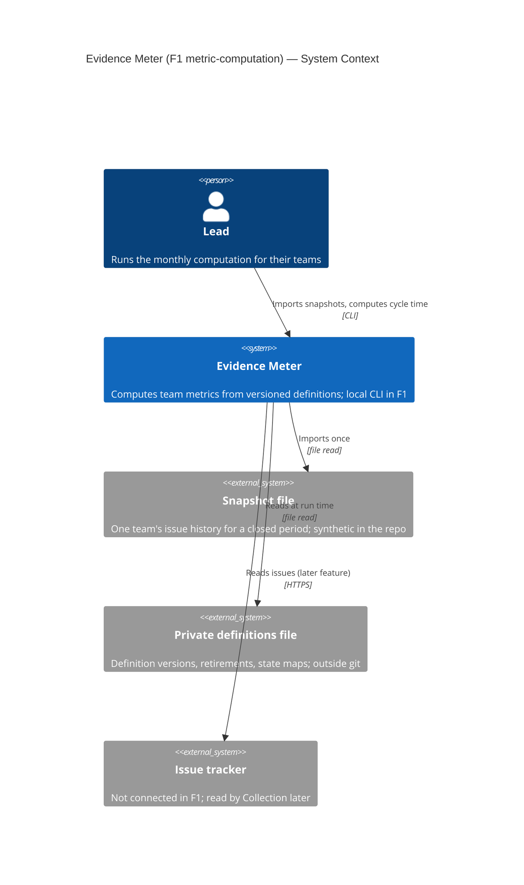
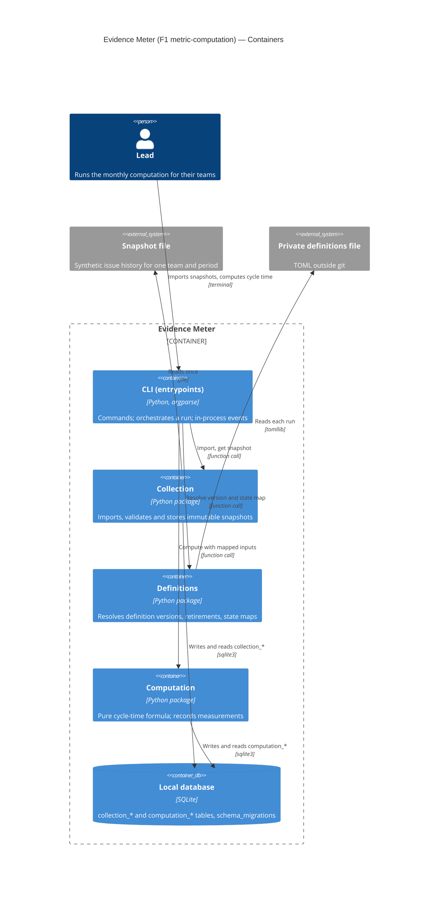
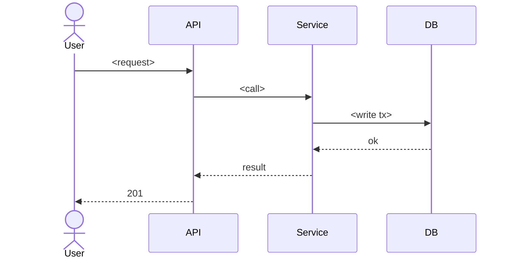

# Software Architecture Document — metric-computation (F1)

<!-- Stages 04-05 → see sdlc/plugin/skills/architecture-design/SKILL.md -->
<!-- 12 Arc42 sections. Empty sections — <!-- N/A: <one-line reason> -->. -->
<!-- C4 Context (L1) lives inline in §3. C4 Container (L2) lives inline in §5. -->
<!-- §6 Runtime view seeds the primary flow(s) here; complete-sequence-diagrams (stage 06) then -->
<!--    fills §6 with every critical flow / §5 AC — no cap. -->
<!-- Numbers in §10 come VERBATIM from PRD §6 NFR — no inventing, no rounding. -->

## 1. Introduction and goals

**Intent.** F1 lets a Lead compute one metric, cycle time (the median duration of the passes a team finished
in a period), for one team and one closed period, without counting by hand. Every value is recorded with
its definition id and version, the state map and the inputs it used, and computing it again gives the same
result. When the data cannot support a value, the Lead gets a plain reason, never a zero or a misleading
number. The core is built so that running it over all teams later is cheap (PRD §1, §2).

**Top-3 quality goals (1-liners; full scenarios in §10):**

1. **Reproducibility** — the same snapshot and definition version always give an identical value and inputs.
2. **Team-level only** — no value, field or log line per person, anywhere.
3. **Honest refusal, all-or-nothing** — a refused or failed run records nothing and gives a plain reason.

Run time (≤ 10 s for 5,000 issues) and offline computation (0 network calls) are quality requirements too;
they get §10 scenarios but do not override the three above.

**Stakeholders.**

| Role | Interest | Sign-off owner? |
|---|---|---|
| Lead | Runs the computation for their teams, reads the unchecked measurement | No |
| Engineering manager | Reads values later on the reviewed monthly page (Reporting); no F1 output | No |
| Tech Lead | Approves this SAD | Yes |
| Security Lead | Review required: size M, person data present in the snapshot (PRD §6.1) | Yes |

<!-- Decision overrides (¶4) — populated by the Step-7 critic resolution loop, empty otherwise. -->

## 2. Constraints

**Technical.**
- Python 3.12 with uv; standard library first. A new dependency needs the owner's OK and a licence and
  maintenance check (AGENTS.md).
- SQLite through the standard `sqlite3` module; plain SQL migrations `migrations/NNNN_<name>.up.sql` /
  `.down.sql` applied by `platform/migrate.py` ([repo ADR 0003](../../adr/0003-persistence-sqlite.md)).
- Modular monolith: five contexts, wired only in `entrypoints/`; the dependency rule is enforced by
  `tests/test_architecture.py` ([repo ADR 0002](../../adr/0002-modular-monolith.md)). Computation `domain`
  imports only the standard library and `shared`.
- CLI on argparse (`entrypoints/cli.py`); FastAPI exists with `/health` only and binds to 127.0.0.1 until
  OIDC sign-in ships ([repo ADR 0004](../../adr/0004-auth-oidc-deferred.md)).

**Organisational.**
- One developer (the capstone owner), AI-assisted.
- Design in week 1 (S7-S8, until 2026-11-26); implementation in week 2 (S9, 2026-11-27 to 2026-12-03).

**Conventions.**
- [AGENTS.md](../../../AGENTS.md), [ARCHITECTURE.md](../../../ARCHITECTURE.md), [bc-map](../../bc-map.md)
  (contexts, events, glossary), [architecture-map](../../architecture-map.md) (current code).
- Failing test first; every metric gets golden data with expected values computed by hand.

**Regulatory / external.**
- The repository is public: synthetic data only in code, tests, fixtures and docs. An organisation's metric
  codes, thresholds and state names live in the private definitions file outside git
  (`~/.config/evidence-meter/`), read only by `definitions/`.
- Results are team-level only; nothing per person in outputs, records or logs (SPEC non-goals).
- The snapshot may carry assignees and authors, so a security review is required (PRD §6.1).

## 3. Context and scope

F1 runs on the Lead's machine as the `evidence-meter` CLI. It takes a team's snapshot from an imported
file and the definition version and state map from the private definitions file, and shows the Lead a
measurement in the terminal, marked as not yet checked. The issue tracker is not connected in F1
([ADR 0001](adr/0001-import-synthetic-snapshot-file-until-collection-adapter-exists.md)); Evidence Guard
and Reporting are internal contexts of later features and receive nothing from F1 beyond the published
`MetricComputed` event. Trust boundary: both files are outside the system and validated on read; nothing
leaves the machine.

**External systems (in / out):**

| Actor or system | Type | Interaction |
|---|---|---|
| Lead | Person | Imports a snapshot, computes cycle time, reads the unchecked measurement in the terminal |
| Snapshot file | External file (synthetic in the repo; a real export stays outside git) | Issues of one team with their state changes for one closed period; imported once, then immutable |
| Private definitions file | External file outside git (`~/.config/evidence-meter/`) | Definition versions, retirements and per-team state maps; read at run time |
| Issue tracker | External system, not connected in F1 | Source of real snapshots once Collection's adapter ships (a later feature) |

**C4 Context (L1):**



## 4. Solution strategy

**Target surface(s) (the first decision — what's being built):** `[cli]` — the `evidence-meter` command on
the Lead's machine. The API keeps `/health` only, so sign-in stays deferred
([ADR 0002](adr/0002-deliver-f1-as-cli-only-and-keep-api-health-only.md); closes PRD §8 open question 2).
No UI surface, so no UI-architecture decision.

**Top strategic choices (the seeds for ADRs):**

1. **Snapshot from an imported file, owned by Collection** — the tracker is not connected in F1; a snapshot
   file is imported once into Collection's store and is immutable from then on. Keeps F1 offline and
   credential-free, and tests use the same path as real runs (QG-1, offline NFR)
   ([ADR 0001](adr/0001-import-synthetic-snapshot-file-until-collection-adapter-exists.md)).
2. **Entrypoint orchestration with in-process events** — the compute command in `entrypoints/` asks
   Definitions for the version and state map, asks Collection for the snapshot, maps both into
   Computation's own input types and runs the use case; every refusal happens before anything is written
   (QG-3). `MetricComputed` goes to an in-process dispatcher with no listeners in F1
   ([ADR 0003](adr/0003-orchestrate-compute-in-entrypoints-with-in-process-events.md)).
3. **Reproducibility by identity** — a snapshot is identified by the sha256 of its canonical content; a
   measurement is unique on team, period, definition id, definition version and snapshot id. A re-run
   compares with the stored measurement: a match records nothing and says so, a difference is reported as a
   defect (QG-1, AC-03)
   ([ADR 0004](adr/0004-identify-snapshots-by-content-hash-and-measurements-by-natural-key.md)).
4. **Privacy by construction** — the import keeps issue keys, states and timestamps and drops assignee and
   author fields, so no person data is stored; a test scans every output, and a person breakdown is refused
   at the CLI (QG-2, AC-09) ([ADR 0005](adr/0005-drop-person-fields-at-snapshot-import.md)).
5. **Pure formula core** (repo convention, no ADR) — pass extraction, state-map application and the median
   are pure functions in `computation/domain/`, taking typed history and the state map as data; golden data
   with hand-computed values is the proof (bc-map, structure per context).

Each tactical decision in later sections should be traceable to one of these strategic seeds. Tactical
decisions that *contradict* a strategic choice are red flags — surface them in §11 Risks.

## 5. Building block view

Modular monolith in one Python process, following the repo: contexts are packages wired only in
`entrypoints/`; Computation is `domain/` → `app/` → `infra/`, the other contexts `handler/` → `service/`
→ `repo/` ([repo ADR 0002](../../adr/0002-modular-monolith.md)). F1 crosses three contexts (Collection,
Definitions, Computation) plus `shared`, `platform` and `entrypoints`; Evidence Guard and Reporting are not
touched. Each context owns its tables in the one SQLite file, prefixed by its name
([ADR 0006](adr/0006-prefix-tables-by-owning-context-in-one-sqlite-file.md)). The private definitions file
is TOML, read with the standard library's `tomllib` (no new dependency, comments allowed for a file the Lead
edits by hand).

**Internal decomposition:**

```
src/evidence_meter/
├── shared/          Team, Period, MetricComputed (event type)
├── platform/        config.py (env), db.py (one SQLite connection helper), migrate.py (exists)
├── collection/
│   ├── handler/     import a snapshot file; get a snapshot by team and period
│   ├── service/     parse and validate, drop person fields, canonicalise, sha256 id
│   └── repo/        collection_* tables
├── definitions/
│   ├── handler/     resolve a definition version and a team's state map
│   ├── service/     published vs retired, current version
│   └── repo/        private TOML file reader (tomllib)
├── computation/
│   ├── domain/      passes, state-map application, median, refusal reasons (pure, stdlib + shared)
│   ├── app/         compute use case; ports: MeasurementStore
│   └── infra/       computation_* tables
└── entrypoints/
    ├── cli.py       `snapshot import`, `compute cycle-time`; maps context results to Computation inputs
    └── dispatch.py  in-process event dispatcher (no listeners in F1)
```

**C4 Container (L2):**



## 6. Runtime view

<!-- 🎯 Навіщо: ПОТІК У RUNTIME для 1-2 критичних сценаріїв. Хто з ким коли і у якому     -->
<!--           порядку говорить. Без §6 §5 — лише купа коробок без життя.                  -->
<!-- 📋 Що писати: Mermaid sequenceDiagram. Учасники — імена з §5 (не вигадуй нові!).      -->
<!--           Повідомлення семантичні («складає чорновик»), БЕЗ HTTP-методів/шляхів —     -->
<!--           ендпоінт-рівневі sequence-діаграми зʼявляться у stage 06 (api-forge).        -->
<!-- ⏳ RESERVED FOR SEQUENCES: architecture-design сіє лише primary flow(s) тут.          -->
<!--           complete-sequence-diagrams (stage 06) ДОПОВНЮЄ §6 кожним критичним flow /    -->
<!--           кожним §5 AC — без обмеження. Не намагайся покрити все тут.                  -->
<!-- 📌 Приклад: «methodist → web-app: складає чорновик → web-app → content-api: зберегти». -->

**Critical flow 1: <flow name>**



<!-- For XS/S: 1 flow above is enough. For M+: add 2-4 more (e.g. failure-mode flow, async flow). -->

**Critical flow 2: <e.g. async event propagation>** — <if applicable, otherwise N/A>.

## 7. Deployment view

<!-- 🎯 Навіщо: ТОПОЛОГІЯ, яку DevOps має знати без читання Helm-чартів — скільки реплік,  -->
<!--           де живе фоновий обробник, ПРИ ЯКИХ ЧИСЛАХ масштабуємось.                     -->
<!-- 📋 Що писати: 2-3 речення про топологію + метрики + алерти + конкретні числа-пороги.   -->
<!-- 📌 Приклад: «500 IC → партиціонування за кварталом» (не «при зростанні подумаємо»).    -->
<!-- 🎯 Можна N/A для XS/S функцій, що переюзають існуюче розгортання без змін.            -->

<Topology in 2-3 sentences. Where it runs (k8s / VM / serverless), replicas, scaling thresholds.>

**Monitoring:**
- <Metrics — e.g. Prometheus `<metric_name>`>
- <Alerts — e.g. "outbox lag > 10 min → page on-call">
- <Tracing — e.g. OpenTelemetry HTTP spans>

**Scaling thresholds:**
- <e.g. 500 IC × 5 goals × 26 checkpoints/Q = 65k rows/year — comfortable in one table>
- <e.g. partitioning by quarter at >500k rows/year>

<!-- For XS/S that doesn't change deployment: <!-- N/A: feature reuses existing deployment unit -->. -->

## 8. Crosscutting concepts

<!-- 🎯 Навіщо: НАСКРІЗНІ ПАТЕРНИ, які перетинають кілька модулів: логування, помилки,    -->
<!--           авторизація, ID strategy, outbox, кеш. ⭐ Друга найгустіша секція.          -->
<!--           Якщо патерн всередині одного модуля — він НЕ сюди. Якщо це конвенція        -->
<!--           проєкту в цілому — у CLAUDE.md.                                              -->
<!-- 📋 Що писати: таблиця концепт / конвенція / де визначено. Один рядок на концепт.      -->
<!-- 📌 Приклад: «UUID v7 (час+випадковий, сортується) у app-layer» — як default з CLAUDE.md. -->

| Concept | Convention | Where defined |
|---|---|---|
| Logging | <e.g. structured slog, fields `module=<name>`> | <CLAUDE.md §X or here> |
| Authentication | <e.g. JWT via session middleware> | <CLAUDE.md §X> |
| Error handling | <e.g. domain sentinel → ports/errors.go → apperr JSON> | <CLAUDE.md §X> |
| ID strategy | <e.g. UUID v7 in app layer> | <CLAUDE.md §X> |
| Internationalisation | <e.g. N/A, English only> | — |
| Observability | <e.g. OpenTelemetry on HTTP boundaries> | — |
| Outbox / events | <module-specific patterns, if any> | <here> |

## 9. Architecture decisions

<!-- 🎯 Навіщо: ЗВОРОТНИЙ ІНДЕКС на папку adr/. `ls adr/` дає файли, §9 дає семантику —    -->
<!--           чому вони існують, до якого зрізу SAD привʼязані, у якому статусі.           -->
<!-- 📋 Що писати: таблиця з 4 колонками. Один рядок на ADR. Mixed status — це OK.         -->
<!-- 📌 Приклад: «0001 | Зберігати урок як таблицю блоків | Accepted | §4».                -->

| # | Title | Status | Section |
|---|---|---|---|
| <NNNN> | <imperative — e.g. "Use sliding window for rate limiting"> | Accepted | §<N> |
| <NNNN> | <imperative — e.g. "Co-locate outbox worker in API process"> | Accepted | §<N> |

ADR files live under `docs/features/<slug>/adr/NNNN-<title>.md`.

## 10. Quality requirements

<!-- 🎯 Навіщо: ДЕРЕВО ЯКОСТЕЙ (Quality Tree) — беремо мету з §1 і розкладаємо на          -->
<!--           конкретні листя: тести, метрики, конфіги, drill-и. ⭐ Без §10 §1 — це       -->
<!--           маніфест. З §10 кожна декларація мапиться на щось, ЩО МОЖНА ДОВЕСТИ.        -->
<!-- 📋 Що писати: на кожну якість з §1 — When / Then / How verify. Числа з PRD §6 NFR     -->
<!--           ДОСЛІВНО (не округлюй p95 ≤250мс до ≤300мс — це F6-помилка критика).        -->
<!-- 📌 Приклад: «p95 ≤500 мс на UPDATE блоку, перевіримо k6 load test 100 req/s».        -->

Each top-3 goal from §1 expanded into a full scenario:

**QG-1. <quality attribute>**
- **When:** <trigger condition>
- **Then:** <expected behavior with numbers from PRD NFR>
- **How verify:** <test / chaos drill / load test / observability>

**QG-2. <quality attribute>**
- **When:** <trigger>
- **Then:** <expected>
- **How verify:** <how>

**QG-3. <quality attribute>**
- **When:** <trigger>
- **Then:** <expected>
- **How verify:** <how>

## 11. Risks and technical debt

<!-- 🎯 Навіщо: ⭐ збирає ВСЕ, що може зламатись — і не лише технічне. Без §11 ризики   -->
<!--           обговорюються на стендапах і губляться; борг лишається у голові того,    -->
<!--           хто його прийняв.                                                          -->
<!-- 📋 Що писати: таблиця ризик/борг — серйозність — мітигація — власник. Технічний    -->
<!--           борг окремою секцією.                                                      -->
<!-- 📌 Приклад: «EM не пушить — member не оновлює дані | High | …». Перший ризик —      -->
<!--           часто продуктовий, не технічний. Це нормально.                            -->

<!-- Severity column literals: Low / Medium / High for regular risks; "Open question" for rows
     created by Step-7 `Save as Open Question` resolutions (see references/socratic-loop.md). -->

| Risk / debt | Severity | Mitigation | Owner |
|---|---|---|---|
| <e.g. Outbox lag may reach hours during downstream outage> | Medium | <Alert >10 min, on-call playbook, retry backoff> | <DevOps> |
| <e.g. No event schema versioning in v1> | Medium | <ADR-NNNN planned for v2, graceful handling of unknown fields> | <Backend> |
| Open architectural decision: <decision-headline> | Open question | Resolve before <stage trigger or YYYY-MM-DD>; <inline rationale from Step-7 Save-as-OQ> | <owner> |

**Accepted debt (acceptable in v1, plan to fix later):**
- <e.g. Goal entity is not versioned (immutable) — OK for v1, may need audit versioning in v2>

## 12. Glossary

<!-- 🎯 Навіщо: ⭐ СЛОВНИК ДОМЕНУ, який припиняє суперечки через рік («checkpoint —      -->
<!--           weekly чи biweekly? Quarter — календарний чи фіскальний?»).                -->
<!-- 📋 Що писати: таблиця термін / значення. Бізнес-терміни + технічні вперемішку.       -->
<!--           Один термін може мати дві мови у заголовку: «Goal (Обʼєктив)».              -->
<!-- 📌 Приклад: «Lesson | урок усередині курсу, що складається з блоків (text, video)». -->

| Term | Meaning |
|---|---|
| <e.g. Goal> | <quarterly intent in statement form> |
| <e.g. KR> | <Key Result — measurable target linked to a Goal> |
| <e.g. Checkpoint> | <bi-weekly progress update on a KR> |
