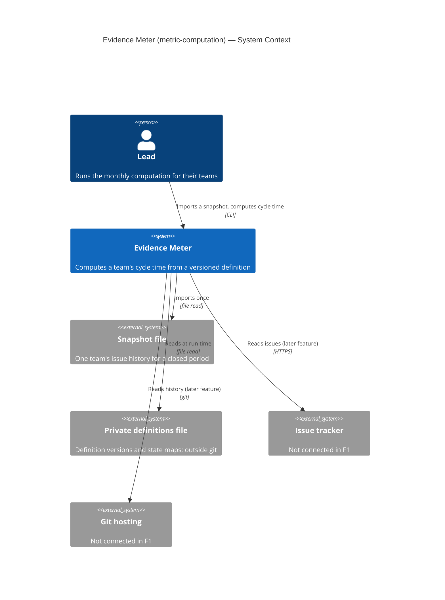
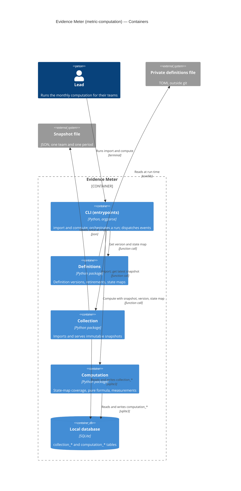
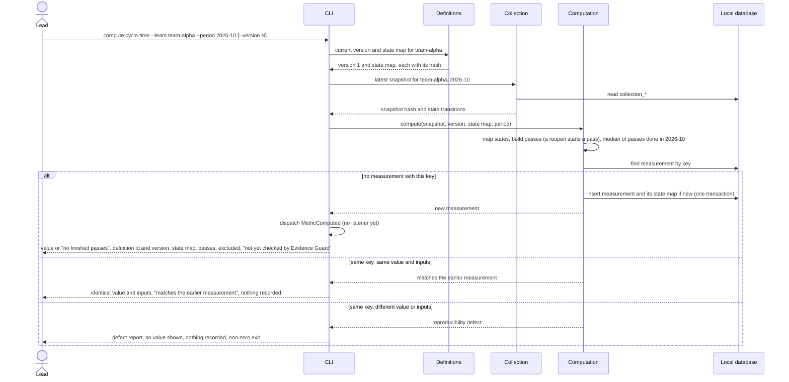
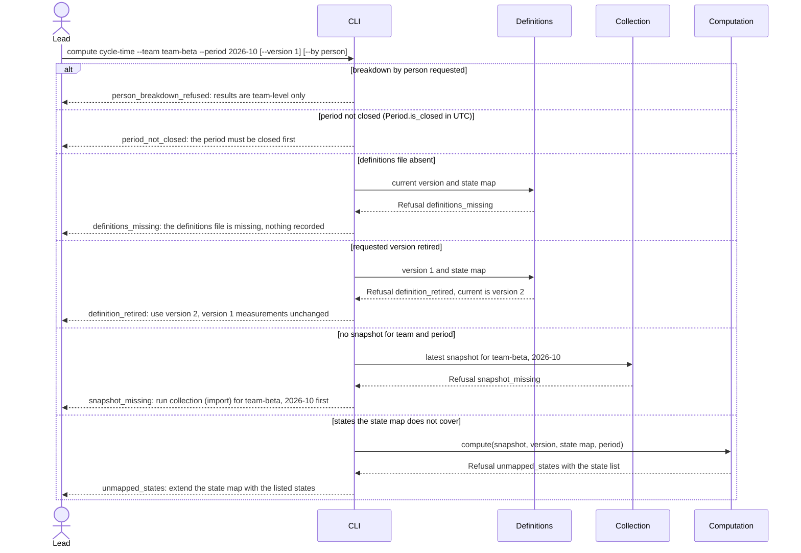
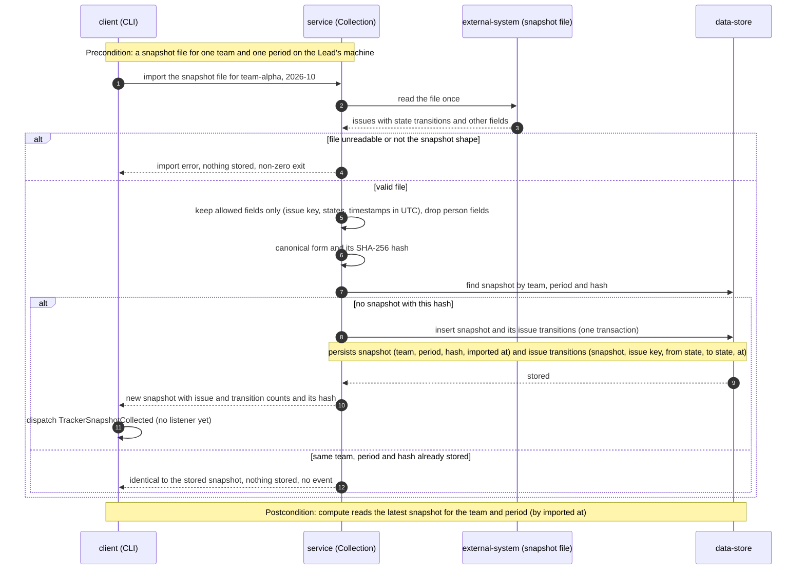

# Software Architecture Document — metric-computation (F1)

> Comparison run of the `sad-builder` skill (depth easy). Inputs: [PRD](PRD.md) ·
> [CONTEXT](CONTEXT.md) · [architecture map](../../architecture-map.md) · [bc-map](../../bc-map.md).
> Feature ADRs ("F1 ADR NNNN") are in [adr/](adr/); repo-wide ones ("repo ADR NNNN") in
> [docs/adr/](../../adr/).

## 1. Introduction and goals

**Intent.** A Lead counts engineering metrics by hand from the written guide, which takes hours per team per
month. F1 lets the Lead name one team and one closed period on the command line and get the first metric,
cycle time, as a Measurement stamped with the definition id, the definition version, the state map and the
inputs it used. Until Evidence Guard exists the Lead sees the value marked as not yet checked; it never
reaches the monthly page. Committed approach (PRD §1): **One team, one number**, with a core that makes
running over all teams cheap later.

**Top-3 quality goals (scenarios in §10):**

1. **Reproducibility** — a re-run gives a 100% identical value and inputs (PRD §6, US-03).
2. **Team-level only** — 0 per-person fields in command output, records or logs (PRD §6, §6.1, AC-09).
3. **All-or-nothing** — 0 partial records after a refused or failed run (PRD §6, every refusal AC).

Run time (5,000 issues) and Offline (0 network calls) get §10 scenarios too; they do not override the three.

**Decision overrides** (critic resolution):
- `shared` carries more than `Team`, `Period` and event types — overridden, rationale: F1 ADR 0002 passes plain
  records (snapshot, definition version, state map) and `Refusal` with its code list between contexts through
  `entrypoints/`; they hold data only, no context logic. ARCHITECTURE.md Layout and the `shared/__init__.py`
  docstring need the same wording (§11).

**Stakeholders.**

| Role | Interest | Sign-off owner? |
|---|---|---|
| Lead | Gets a team's cycle time without counting by hand; sees what made it and why a value is missing | No |
| Tech Lead | Approves this SAD | Yes |
| Security Lead | Size M and a new boundary around person data in the snapshot (PRD §6.1 "Security review: Required") | Yes |

## 2. Constraints

**Technical.**
- Python 3.12 with uv; standard library first; a new dependency needs the owner's OK (AGENTS.md). F1 adds
  none: JSON through `json`, TOML through `tomllib`.
- SQLite via `sqlite3`; migrations `NNNN_<name>.up/.down.sql` by `platform/migrate.py` (repo ADR 0003).
- Modular monolith, dependency rule in `tests/test_architecture.py` (repo ADR 0002); Computation `domain`
  imports only the standard library and `shared`.
- argparse CLI (repo ADR 0001); the API and web dev server bind to 127.0.0.1 until OIDC (repo ADR 0004).

**Organisational.**
- One person builds the tool; the capstone gives a fixed delivery window this month (PRD §1).

**Conventions.**
- AGENTS.md, ARCHITECTURE.md, bc-map, architecture-map; failing test first; golden data with expected
  values computed by hand; `make check` before each commit.

**Regulatory / external.**
- Public repository: synthetic data only; private definitions outside git, read only by Definitions.
- Team-level only; the snapshot may carry assignees and authors, F1 reads states and timestamps only and
  outputs no field per person (PRD §6.1).

## 3. Context and scope

In F1 Evidence Meter computes one metric, cycle time, for one team and one closed period, on the Lead's
own machine. It reads the Lead's private definitions file and a snapshot file of one team's issue history;
the issue tracker and Git hosting are connected by later Collection features. Trust boundary: everything
runs locally; the only person data that enters is inside the snapshot file.

**External systems (in / out):**

| Actor or system | Type | Interaction |
|---|---|---|
| Lead | Person | Imports a snapshot, computes cycle time, reads the measurement or the refusal in the terminal |
| Private definitions file | External file outside git | Definition versions, retirements and per-team state maps; read at run time, never written |
| Snapshot file | External file (synthetic in the repo, local elsewhere) | One team's issue state history for one closed period; read once at import |
| Issue tracker | External system, later feature | Not connected in F1 |
| Git hosting | External system, later feature | Not connected in F1 |

**C4 Context (L1):**



## 4. Solution strategy

**Target surface(s):** `[cli]` — F1 stays on the Lead's machine; an API route would make F1 the first
data-serving feature and bring OIDC sign-in (repo ADR 0004). Closes PRD open question 2
([F1 ADR 0001](adr/0001-entrypoints-serve-f1-through-the-cli-only.md)).

**Strategic choices:**

1. **Orchestrate one run in the CLI, with shared types and in-process events** — the `compute` command in
   `entrypoints/` asks Definitions for the version and state map, Collection for the snapshot, then
   Computation for the measurement, passing plain `shared` types; F1 defines `shared/events.py` and publishes
   `TrackerSnapshotCollected` and `MetricComputed` to an in-process dispatcher with no listener yet. Serves
   all-or-nothing: every check runs before the first write
   ([F1 ADR 0002](adr/0002-entrypoints-orchestrate-a-run-with-shared-types.md)).
2. **Import a snapshot file into an immutable stored snapshot** — Collection's `import` command reads one
   JSON snapshot file, stores it in `collection_*` tables with a SHA-256 hash of its canonical form; an
   identical re-import is a no-op, a different file for the same team and period is a new snapshot, and
   compute uses the latest. Closes PRD open question 1; serves reproducibility
   ([F1 ADR 0003](adr/0003-collection-import-a-snapshot-file-as-an-immutable-snapshot.md)).
3. **Drop person fields at import** — Collection keeps issue key, state transitions and timestamps only;
   assignees and authors never reach SQLite, logs or Computation. Serves team-level only
   ([F1 ADR 0004](adr/0004-collection-drop-person-fields-at-import.md)).

Later tactical decisions trace to one of these; a contradiction is a §11 risk.

## 5. Building block view

Modular monolith, one package per context (repo ADR 0002). F1 touches three contexts and wires them only in
`entrypoints/` (F1 ADR 0002): Definitions reads the private file, Collection imports and serves the
snapshot, Computation applies the state map in `app/` and the pure formula in `domain/`, then records the
measurement in `infra/`. No context imports another; records cross the boundary as `shared` types.

**Context touch list:**

| Part | Changes | Tables (prefix) | Events published / consumed |
|---|---|---|---|
| `shared` | `Team`, `Period`, `Refusal` with its code list, snapshot and definition records, `events.py` | — | defines `TrackerSnapshotCollected`, `MetricComputed` |
| `platform` | new `config.py` (`EVIDENCE_METER_DB`, `EVIDENCE_METER_DEFINITIONS`), new `db.py` (connection, one transaction per command) | — | — |
| Collection | `handler/` import command, `service/` allow-list and canonical hash, `repo/` snapshot store | `collection_snapshots`, `collection_issue_transitions` | publishes `TrackerSnapshotCollected` |
| Definitions | `handler/` lookup, `service/` validation and hashing of version and state map, `repo/` TOML reader | none | none in F1 (§11 debt) |
| Computation | `domain/` passes, median, cycle-time formula, period rule; `app/` compute use case; `infra/` measurement store | `computation_measurements`, `computation_state_maps` | publishes `MetricComputed` |
| `entrypoints` | `cli.py` `import` and `compute`; in-process dispatcher | — | dispatches both events (no listener yet) |
| `migrations/` | `0002_collection_snapshots`, `0003_computation_measurements` (columns: `generate-data-model`) | — | — |
| Evidence Guard, Reporting, API, web | not touched | — | — |

**Internal decomposition:**

```
src/evidence_meter/
├── shared/                   Team, Period, Refusal codes, records, events
├── platform/config.py, db.py env settings; connection and transaction helper
├── collection/handler/       import a snapshot file; get the latest snapshot for team + period
├── collection/service/       allow-list of fields, canonical form, SHA-256 hash
├── collection/repo/          collection_* tables
├── definitions/handler/      current or named version; team state map
├── definitions/service/      validate, retired check data, hash version and state map
├── definitions/repo/         read the TOML file with tomllib
├── computation/domain/       passes from abstract transitions, median, cycle time; closed-period rule
├── computation/app/          compute use case: checks, state-map coverage, key lookup, record
├── computation/infra/        computation_measurements, computation_state_maps (each map used, by hash)
└── entrypoints/cli.py        import, compute; dispatcher
```

**C4 Container (L2):**



## 6. Runtime view

Seed flows: the happy path with its re-run, and the flow with every refusal. Checks run in a fixed order,
cheapest and without I/O first, and all of them before the first write (F1 ADR 0002): per-person breakdown,
period closed ([F1 ADR 0006](adr/0006-shared-store-utc-and-close-periods-by-utc-month.md)), definitions
file, retired version, snapshot, state-map coverage. Refusals travel as typed results
([F1 ADR 0007](adr/0007-shared-return-refusals-as-typed-results.md)). `/sdlc:complete-sequence-diagrams`
adds the import flow and the coverage table.

### Critical flow 1: compute and re-run (AC-01, AC-01b, AC-02, AC-03, AC-08)



### Critical flow 2: refusals (AC-09, AC-06, AC-05, AC-10, AC-07, AC-04)



Every branch of flow 2 writes nothing; each reply exits with a non-zero code distinct from the defect's.

### Flow 3: import a snapshot file (precondition of AC-07)



A different file for the same team and period is a new snapshot (new hash); the older one stays and its
measurements keep pointing at it (F1 ADR 0003, F1 ADR 0008).

**Event ledger:**

| Event | bc-map owner | In this feature |
|---|---|---|
| `TrackerSnapshotCollected` | Collection | published by the `import` command after a new snapshot (not on a no-op); no listener yet |
| `GitHistoryCollected` | Collection | not yet: no Git source in F1 (§11 debt) |
| `CollectionFailed` | Collection | not yet: an import error is printed to the terminal; Reporting does not exist (§11 debt) |
| `DefinitionVersionPublished` | Definitions | not yet: the file is read at run time (§11 debt) |
| `DefinitionVersionRetired` | Definitions | not yet as an event: retirement is read from the file at run time and refused (AC-10) (§11 debt) |
| `MetricComputed` | Computation | published by `compute` after a new measurement; no listener until Evidence Guard |
| `ReportingPeriodClosed` | external trigger | not produced: closure is the UTC calendar rule on `Period` (§11 debt) |

### Coverage: US/AC → flows

| ID | Realized by (§6 heading) | How | Note |
|---|---|---|---|
| US-01 | Critical flow 1: compute and re-run | flow | |
| US-02 | Critical flow 1: compute and re-run | flow | reply names definition, version, state map, passes, excluded |
| US-03 | Critical flow 1: compute and re-run | flow | |
| US-04 | Critical flow 2: refusals | flow | |
| US-05 | Critical flow 1: compute and re-run | flow | step "map states, build passes (a reopen starts a pass)" |
| US-06 | Critical flow 2: refusals | flow | |
| US-07 | Critical flow 2: refusals | flow | |
| AC-01 | Critical flow 1: compute and re-run | flow | `alt no measurement with this key` |
| AC-01b | Critical flow 1: compute and re-run | branch | `alt no measurement with this key`, reply "no finished passes" |
| AC-02 | Critical flow 1: compute and re-run | flow | reply of `alt no measurement with this key` |
| AC-03 | Critical flow 1: compute and re-run | branch | `else same key, same value and inputs`; `else same key, different value or inputs` (defect) |
| AC-04 | Critical flow 2: refusals | branch | `else states the state map does not cover` |
| AC-05 | Critical flow 2: refusals | branch | `else definitions file absent` |
| AC-06 | Critical flow 2: refusals | branch | `else period not closed` |
| AC-07 | Critical flow 2: refusals; Flow 3: import a snapshot file | branch | `else no snapshot for team and period`; flow 3 is the fix it names |
| AC-08 | Critical flow 1: compute and re-run | flow | step "map states, build passes (a reopen starts a pass)" |
| AC-09 | Critical flow 2: refusals | branch | `alt breakdown by person requested` |
| AC-10 | Critical flow 2: refusals | branch | `else requested version retired` |

Coverage: 7/7 user stories · 11/11 ACs — 0 non-runtime N/A.

**Flags:**
- Flow 3 adds participant `external-system (snapshot file)`; §5 declares it as `System_Ext(snap)`, so no new participant for architecture-design.
- Open for data-model: whether `import` refuses a snapshot of a period that is not closed yet; the SAD is silent (compute refuses it, AC-06).
- Flows 1 and 2 predate this skill and carry no persist notes; their writes are `computation_measurements` and `computation_state_maps` (§5 touch list).

## 7. Deployment view

<!-- N/A: F1 has the cli surface only (F1 ADR 0001); nothing is deployed or served. -->

F1 runs on the Lead's laptop as the `evidence-meter` command against one SQLite file in `var/` (gitignored,
`EVIDENCE_METER_DB`). Capacity: one team and period with a snapshot of up to 5,000 issues within the §10
run-time target; each import adds one snapshot's rows, so the file grows by imports, not by re-runs.

## 8. Crosscutting concepts

| Concept | Convention | Where defined |
|---|---|---|
| Logging | stderr only; refusal codes, counts and hashes, never a person field, a tracker state name, a team id, a definition id or an issue key | here |
| Authentication | none: CLI only, no data-serving surface; OIDC arrives with the first one (repo ADR 0004) | [F1 ADR 0001](adr/0001-entrypoints-serve-f1-through-the-cli-only.md) |
| Capability rule | Team-level only; `--by` accepts `team` or `person`, and `person` is refused (`person_breakdown_refused`) before any I/O; `--version N` names a definition version (default: the current one, AC-10) | AGENTS.md, PRD AC-09 |
| Refusal codes | closed list, one per AC: `person_breakdown_refused` (AC-09), `period_not_closed` (AC-06), `definitions_missing` (AC-05), `definition_retired` (AC-10), `snapshot_missing` (AC-07), `unmapped_states` (AC-04); the AC-03 mismatch is a defect, not a refusal | [F1 ADR 0007](adr/0007-shared-return-refusals-as-typed-results.md) |
| ID strategy | snapshot: team, period and SHA-256 of the canonical form; measurement: unique key of team, period, definition id, version number, version hash, snapshot hash, state-map hash | [F1 ADR 0003](adr/0003-collection-import-a-snapshot-file-as-an-immutable-snapshot.md), [F1 ADR 0008](adr/0008-computation-key-measurements-by-every-input.md) |
| No value | outcome `value` or `no_finished_passes`; value NULL only with the second; never zero | [F1 ADR 0009](adr/0009-computation-record-no-finished-passes-as-an-outcome.md) |
| Time and period | stored timestamps in UTC; `Period` `YYYY-MM` closed when the UTC month has ended; a pass counts in the UTC month of its done | [F1 ADR 0006](adr/0006-shared-store-utc-and-close-periods-by-utc-month.md) |
| Transactions | every check before the first write; one transaction per write command (`import`, `compute`) through `platform/db.py` | here, [F1 ADR 0002](adr/0002-entrypoints-orchestrate-a-run-with-shared-types.md) |
| Events | types in `shared/events.py`; in-process dispatcher in `entrypoints/`; F1 publishes `TrackerSnapshotCollected` and `MetricComputed` | [F1 ADR 0002](adr/0002-entrypoints-orchestrate-a-run-with-shared-types.md) |
| Privacy ledger | see below; private names include team ids, definition ids and issue keys (they may carry an organisation's project key) | [F1 ADR 0004](adr/0004-collection-drop-person-fields-at-import.md) |
| Offline | no network code in F1; a test blocks sockets during `compute` | PRD §6, SPEC criterion 8 |
| Configuration | `EVIDENCE_METER_DB`, `EVIDENCE_METER_DEFINITIONS` (default `~/.config/evidence-meter/definitions.toml`) in `platform/config.py` | here, [F1 ADR 0005](adr/0005-definitions-read-a-toml-definitions-file.md) |
| Internationalisation | English only | — |

**Privacy ledger** (every place person data or private names could land):

| Place | Person data | Private names (state names, definition codes) |
|---|---|---|
| Snapshot file | may hold assignees and authors; the Lead's local file, never committed; import ignores those fields | tracker state names; local only |
| `collection_*` tables | never: allow-list at import (F1 ADR 0004) | only here: tracker state names, team ids and issue keys, in the gitignored local SQLite file |
| `computation_measurements` | never: team, period, counts, hashes | only here: team id and definition id in the key, in the gitignored local SQLite file |
| `computation_state_maps` | never | only here: each state map used (tracker state names), kept so a measurement stays traceable after the file is edited; gitignored local SQLite file |
| Events in memory | never | team id and definition id only, in process; never written or logged |
| Logs (stderr) | never | never |
| Terminal reply | never | only here: unmapped state names and the state map shown to the local Lead (PRD §6.1) |
| Repo files and test fixtures | never: synthetic teams and issues only | never: synthetic state names only |
| Private definitions file | none | only here: outside git, read only by Definitions |

## 9. Architecture decisions

| # | Title | Owning context | Gate | Status | Section |
|---|---|---|---|---|---|
| [0001](adr/0001-entrypoints-serve-f1-through-the-cli-only.md) | Serve F1 through the CLI only | entrypoints | 3/4 | Accepted | §4 |
| [0002](adr/0002-entrypoints-orchestrate-a-run-with-shared-types.md) | Orchestrate a run in entrypoints with shared types and in-process events | entrypoints | 3/4 | Accepted | §4 |
| [0003](adr/0003-collection-import-a-snapshot-file-as-an-immutable-snapshot.md) | Import a snapshot file as an immutable stored snapshot | collection | 4/4 | Accepted | §4 |
| [0004](adr/0004-collection-drop-person-fields-at-import.md) | Drop person fields at import | collection | 3/4 | Accepted | §4 |
| [0005](adr/0005-definitions-read-a-toml-definitions-file.md) | Read a TOML definitions file with tomllib | definitions | 2/4 | Accepted | §5 |
| [0006](adr/0006-shared-store-utc-and-close-periods-by-utc-month.md) | Store timestamps in UTC and close periods by the UTC calendar month | shared | 4/4 | Accepted | §6 |
| [0007](adr/0007-shared-return-refusals-as-typed-results.md) | Return refusals as typed results with a closed code list | shared | 3/4 | Accepted | §6 |
| [0008](adr/0008-computation-key-measurements-by-every-input.md) | Key measurements by every input | computation | 3/4 | Accepted | §8 |
| [0009](adr/0009-computation-record-no-finished-passes-as-an-outcome.md) | Record "no finished passes" as an outcome, never as zero | computation | 3/4 | Accepted | §8 |

Feature ADRs live in `adr/`; repo-wide ones in `docs/adr/` ("repo ADR NNNN").

## 10. Quality requirements

**QG-1. Reproducibility**
- **When:** the Lead computes again with the same snapshot, definition version and state map (AC-03).
- **Then:** 100% identical value and inputs on re-run
- **How verify:** re-run test over the golden data in `make check` (`tests/test_compute_reproducibility.py`)

**QG-2. Team-level only**
- **When:** any command runs, including one that asks for a breakdown by person (AC-09).
- **Then:** 0 per-person fields in command output, records or logs
- **How verify:** a test scans every output (SPEC acceptance criterion 5) (`tests/test_person_fields.py`)

**QG-3. All-or-nothing**
- **When:** a run is refused (AC-04, AC-05, AC-06, AC-07, AC-09, AC-10) or fails, including the AC-03 defect.
- **Then:** 0 partial records after a refused or failed run
- **How verify:** test that every refusal AC leaves the store unchanged (`tests/test_all_or_nothing.py`)

**QG-4. Run time**
- **When:** the Lead computes one team and period, snapshot up to 5,000 issues.
- **Then:** ≤ 10 s on a developer laptop
- **How verify:** timed test in CI on a synthetic 5,000-issue snapshot (`tests/test_compute_runtime.py`)

**QG-5. Offline**
- **When:** the Lead computes any team and period.
- **Then:** 0 network calls during computation
- **How verify:** test with network access blocked (SPEC acceptance criterion 8) (`tests/test_offline.py`)

## 11. Risks and technical debt

| Risk / debt | Severity | Mitigation | Owner |
|---|---|---|---|
| R1. A value for a team of one or two people is effectively one person's value, and the Lead sees it unchecked | High | F1 output stays local and marked "not yet checked by Evidence Guard"; the threshold belongs to Evidence Guard | capstone owner |
| Open question (PRD §8): from what team size is a team value effectively personal? Default: no limit in F1 | Open question | Resolve in the Evidence Guard feature PRD; it decides R1 | capstone owner |
| R2. Work done late on the last local day of a month lands in the next UTC month for teams far from UTC (F1 ADR 0006) | Low | Revisit with pilot data; a timezone would become a key input | capstone owner |
| R3. The JSON snapshot shape may not fit a real tracker's history (F1 ADR 0003) | Medium | Tracker adapters map into the same `collection_*` tables; golden data stays on the JSON shape | capstone owner |
| R4. Several measurements per team and period; "current" is a read rule (F1 ADR 0008) | Medium | Evidence Guard and Reporting adopt one rule: latest snapshot, current version and state map | capstone owner |
| R5. Real tracker state names in the local SQLite file and terminal (§8 privacy ledger) | Medium | `var/` gitignored; never logged; QG-2 test covers logs | capstone owner |
| Open question (PRD §7 KPI 3): where are refused-run counts kept to measure "share of runs refused for unmapped states", given AC-04 records nothing? | Open question | Resolve before F1 release, at `/sdlc:break-tasks`; until then KPI 3 has no data | capstone owner |
| R6. The 10 s target for 5,000 issues is unproven | Low | QG-4 timed test from the first formula commit | capstone owner |

**Accepted debt:**
- bc-map events not produced in F1 (§6 event ledger): `GitHistoryCollected` (no Git source), `CollectionFailed`
  (no Reporting; import errors go to the terminal), `DefinitionVersionPublished` and `DefinitionVersionRetired`
  (the file is read at run time), `ReportingPeriodClosed` (UTC calendar rule instead).
- `TrackerSnapshotCollected` is published but Computation will not consume it: compute runs on the Lead's
  request (F1 ADR 0002). bc-map Map and the ARCHITECTURE.md event table need an update (owner: capstone owner).
- ARCHITECTURE.md Layout and the `shared/__init__.py` docstring still describe `shared` as `Team`, `Period`
  and event types only (§1 override).
- Architecture-map gaps F1 does not fix: the API envelope covers `HTTPException` only; `revert_last()` does
  not re-check the migration name; no MCP surface. F1 does add the missing settings module and connection
  helper in `platform/`.

## 12. Glossary

| Term | Meaning |
|---|---|
| Cycle time | the median duration of the passes a team finished in a period, each pass measured from its start to its done. NOT lead time, which runs from the request (issue created) or the first commit, not from the start of work. |
| DefinitionVersion | an immutable, numbered version of a metric definition that names its formula, its inputs and its minimum data. NOT MetricDefinition, which is the named metric across all its versions. |
| Formula | a pure function, named by a FormulaId, that turns inputs into a value without reading or writing anything. NOT DefinitionVersion, which names a formula and its inputs as data; the formula itself is code. |
| FormulaId | which pure formula a definition names (bc-map). |
| Input | a named value read from one snapshot that a formula consumes, for example the count of issues closed in the period. NOT Snapshot, which is the whole immutable collection the input is read from. |
| Lead | the person who runs the monthly computation for the teams they are responsible for and reviews the values before the page is drafted. NOT a team member being measured: the tool reports on the team, never on the lead or any other person. |
| Measurement | the raw value computed for one team, one period and one definition version, together with the inputs it used. NOT a value that may be published: a measurement goes on a page only after Evidence Guard returns a Verdict; before that only the lead sees it, marked as not yet checked. When no passes were finished in the period, a measurement has no value (the median is not defined); it never becomes zero. |
| Pass | one stretch of work on an issue from a start (first start, or a reopen) to the next done; a reopened issue has several passes, each counted in the period of its own done. NOT Issue, which can have one or more passes. |
| Period | a closed calendar month for which values are computed, identified as YYYY-MM. NOT a sprint or iteration from the tracker, whose dates vary by team. |
| Snapshot | the immutable collection of one team's tracker data for one period (bc-map, Collection). |
| State map | one team's mapping from its tracker states to the abstract states a definition version uses (started, done, excluded), kept in the private definitions file. NOT IssueState, which is the state an issue actually has in the tracker. |
| Refusal code | *new* — one code from the closed list in §8 that names why nothing was computed; one per PRD AC. NOT a Verdict, which Evidence Guard gives about a computed value. |
| Snapshot hash | *new* — SHA-256 of a snapshot's canonical form (stored fields only, UTC timestamps). NOT the snapshot file's checksum, which changes with formatting and ignored fields. |
| Measurement key | *new* — team, period, definition id, version number, version hash, snapshot hash, state-map hash. NOT the period alone: one team and period can have several measurements. |
| Outcome | *new* — `value` or `no_finished_passes`, stored with every measurement. NOT a Verdict: an outcome says what the formula produced, not whether it may be shown. |
