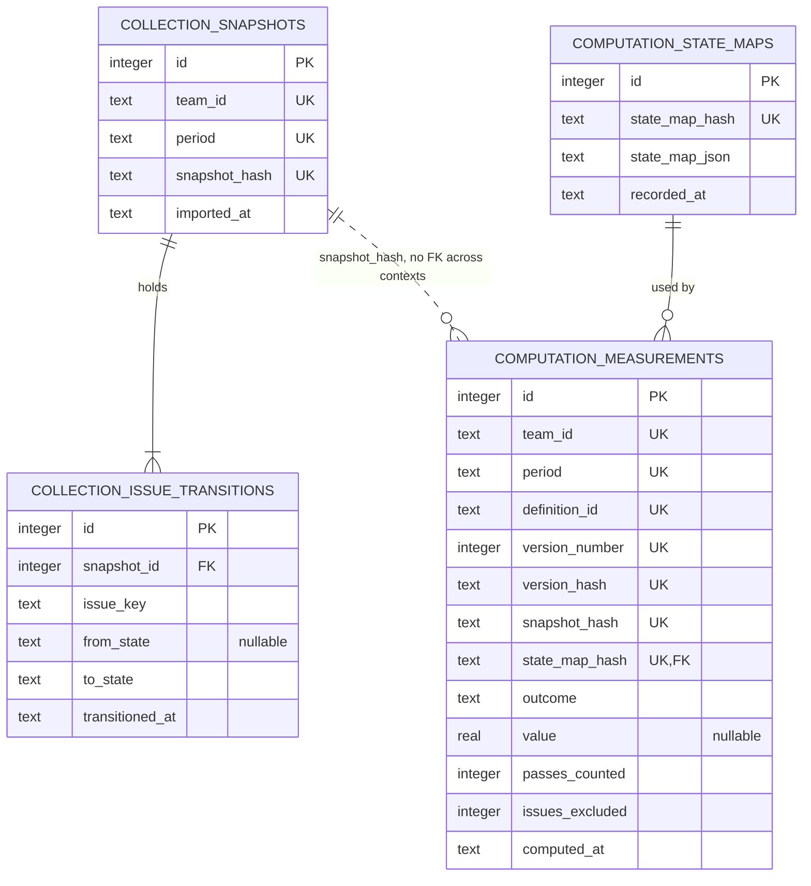

# Data model — metric-computation

<!-- data-model-builder (comparison run, --depth easy, --out-dir skill-run). Rules: the skill's
templates/rules-migrations-sqlite.md (treated as .claude/rules/migrations.md, which this run takes as
absent and does not write). Inputs: PRD, SAD §5/§6/§8, ADR Stored data. -->

## Storage ledger

| Table | Context | Root or child | ADR Stored data | Flow steps (quoted) | ACs |
|---|---|---|---|---|---|
| `collection_snapshots` | collection | root | [F1 ADR 0003](../adr/0003-collection-import-a-snapshot-file-as-an-immutable-snapshot.md) "(team, period, hash, imported_at)"; [0004](../adr/0004-collection-drop-person-fields-at-import.md); [0006](../adr/0006-shared-store-utc-and-close-periods-by-utc-month.md) | flow 3 "find snapshot by team, period and hash", "insert snapshot and its issue transitions (one transaction)"; flow 1 "latest snapshot for team-alpha, 2026-10", "read collection_*" | AC-01, AC-03, AC-07 |
| `collection_issue_transitions` | collection | child of `collection_snapshots` | F1 ADR 0003 "(snapshot, issue key, from state, to state, at)"; 0004 (allow-list); 0006 (UTC) | flow 3 "insert snapshot and its issue transitions (one transaction)"; flow 1 "read collection_*" → "snapshot hash and state transitions" | AC-01, AC-01b, AC-04, AC-08 |
| `computation_state_maps` | computation | root | [F1 ADR 0008](../adr/0008-computation-key-measurements-by-every-input.md) "keeps each state map used, by hash"; [0005](../adr/0005-definitions-read-a-toml-definitions-file.md) (hash of parsed canonical form) | flow 1 "insert measurement and its state map if new (one transaction)" | AC-02 |
| `computation_measurements` | computation | root | F1 ADR 0008 "unique index over the seven key columns, plus outcome, value, passes counted and issues excluded"; [0009](../adr/0009-computation-record-no-finished-passes-as-an-outcome.md) "outcome (closed list) and nullable value" | flow 1 "find measurement by key", "insert measurement and its state map if new (one transaction)" | AC-01, AC-01b, AC-02, AC-03, AC-08, AC-10 |

Every table in the SAD §5 touch list has an ADR and a flow step; every Stored data line and persist step has
a table. Definitions stores nothing (F1 ADR 0005: the TOML file is its store).

## ER diagram

Validated with the project's `mermaid` package (`mermaid.parse`, from `web/`); `mmdc` cannot start here.

## Tables

### `collection_snapshots` (root of Snapshot, migration `0002_create_collection_snapshots`)

| Column | Type | Constraints | Source |
|---|---|---|---|
| `id` | INTEGER | PK | rules |
| `team_id` | TEXT | NOT NULL, key | ADR 0003 "team"; SAD §8 ID strategy |
| `period` | TEXT | NOT NULL, key; `YYYY-MM` (app-validated) | ADR 0003 "period"; CONTEXT "Period" |
| `snapshot_hash` | TEXT | NOT NULL, key; hex SHA-256 | ADR 0003 "hash"; ADR 0004 (allowed fields only) |
| `imported_at` | TEXT | NOT NULL | ADR 0003 "imported_at"; ISO 8601 UTC `Z`, app-set (ADR 0006) |

**Natural key:** `team, period and SHA-256 of the canonical form` → `UNIQUE (team_id, period, snapshot_hash)`.
**Lifecycle:** insert only; an identical re-import is a no-op (flow 3), a different file is a new row.

### `collection_issue_transitions` (child of Snapshot, migration `0002_create_collection_snapshots`)

| Column | Type | Constraints | Source |
|---|---|---|---|
| `id` | INTEGER | PK | rules |
| `snapshot_id` | INTEGER | NOT NULL, FK → `collection_snapshots.id` | ADR 0003 "snapshot" |
| `issue_key` | TEXT | NOT NULL | ADR 0003 "issue key"; ADR 0004 (kept: identifies work, not people) |
| `from_state` | TEXT | nullable (first transition of an issue has none) | ADR 0003 "from state" |
| `to_state` | TEXT | NOT NULL | ADR 0003 "to state" |
| `transitioned_at` | TEXT | NOT NULL | ADR 0003 "at"; ISO 8601 UTC `Z` (ADR 0006) |

**Natural key:** none named in SAD §8; a transition's identity is its snapshot plus position (see
assumptions). **Lifecycle:** insert only, with its snapshot in one transaction.

### `computation_state_maps` (root of StateMap record, migration `0003_create_computation_measurements`)

| Column | Type | Constraints | Source |
|---|---|---|---|
| `id` | INTEGER | PK | rules |
| `state_map_hash` | TEXT | NOT NULL, UNIQUE; hex SHA-256 | ADR 0008 "by hash"; ADR 0005 (parsed canonical form) |
| `state_map_json` | TEXT | NOT NULL; the canonical JSON that is hashed | ADR 0008 "keeps each state map used" (rules: JSON only when it is the hashed form) |
| `recorded_at` | TEXT | NOT NULL | ISO 8601 UTC `Z`, app-set (ADR 0006) |

**Natural key:** `state_map_hash`. **Lifecycle:** insert if new (flow 1), never updated.

### `computation_measurements` (root of Measurement, migration `0003_create_computation_measurements`)

| Column | Type | Constraints | Source |
|---|---|---|---|
| `id` | INTEGER | PK | rules |
| `team_id` | TEXT | NOT NULL, key | ADR 0008 key "team" |
| `period` | TEXT | NOT NULL, key | ADR 0008 key "period" |
| `definition_id` | TEXT | NOT NULL, key | ADR 0008 key "definition id" |
| `version_number` | INTEGER | NOT NULL, key | ADR 0008 key "version number" |
| `version_hash` | TEXT | NOT NULL, key; hex SHA-256 | ADR 0008 key "version hash"; ADR 0005 |
| `snapshot_hash` | TEXT | NOT NULL, key; no FK (Collection's row, by hash) | ADR 0008 key "snapshot hash"; SAD §8 |
| `state_map_hash` | TEXT | NOT NULL, key, FK → `computation_state_maps.state_map_hash` | ADR 0008 key "state-map hash" |
| `outcome` | TEXT | NOT NULL; `value` or `no_finished_passes` (CHECK, ADR 0009) | ADR 0009 |
| `value` | REAL | nullable; NULL only with `no_finished_passes` (CHECK, ADR 0009) | ADR 0009; AC-01b |
| `passes_counted` | INTEGER | NOT NULL | ADR 0008 "passes counted"; AC-02 |
| `issues_excluded` | INTEGER | NOT NULL | ADR 0008 "issues excluded"; AC-02 |
| `computed_at` | TEXT | NOT NULL | ISO 8601 UTC `Z`, app-set (ADR 0006) |

**Natural key (verbatim, SAD §8):** `team, period, definition id, version number, version hash, snapshot
hash, state-map hash` → one `UNIQUE` over the seven columns in that order. **Lifecycle:** insert only; the
same key with a different outcome or value is a defect reported by the app, never an update (AC-03).
**CHECK:** the one CHECK is the outcome/value pair that Accepted F1 ADR 0009 asks for, commented in the SQL.

## Queries and indexes

Queries are in [queries.sql](queries.sql); plans from `roundtrip.py`.

| Query (flow step) | SQL | Index | Plan |
|---|---|---|---|
| flow 3 "find snapshot by team, period and hash" | `SELECT id FROM collection_snapshots WHERE team_id = ? AND period = ? AND snapshot_hash = ?` | `UNIQUE (team_id, period, snapshot_hash)` | SEARCH USING COVERING INDEX sqlite_autoindex_collection_snapshots_1 (team_id=? AND period=? AND snapshot_hash=?) |
| flow 1 "latest snapshot for team-alpha, 2026-10" | `SELECT id, snapshot_hash FROM collection_snapshots WHERE team_id = ? AND period = ? ORDER BY imported_at DESC, id DESC LIMIT 1` | `UNIQUE (team_id, period, snapshot_hash)` (prefix) | SEARCH USING INDEX sqlite_autoindex_collection_snapshots_1 (team_id=? AND period=?); USE TEMP B-TREE FOR ORDER BY |
| flow 1 "read collection_*" (transitions of the snapshot) | `SELECT issue_key, from_state, to_state, transitioned_at FROM collection_issue_transitions WHERE snapshot_id = ? ORDER BY issue_key, transitioned_at` | `idx_collection_issue_transitions_snapshot (snapshot_id, issue_key, transitioned_at)`; also the FK index | SEARCH USING INDEX idx_collection_issue_transitions_snapshot (snapshot_id=?) |
| flow 1 "find measurement by key" | `SELECT outcome, value, passes_counted, issues_excluded FROM computation_measurements WHERE <seven key columns> = ?` | `UNIQUE (team_id, ..., state_map_hash)` | SEARCH USING INDEX sqlite_autoindex_computation_measurements_1 (all seven =?) |
| flow 1 "its state map if new" | `SELECT id FROM computation_state_maps WHERE state_map_hash = ?` | `UNIQUE (state_map_hash)` | SEARCH USING COVERING INDEX sqlite_autoindex_computation_state_maps_1 (state_map_hash=?) |
| none: FK rule only | — | `idx_computation_measurements_state_map (state_map_hash)` | — |

## Privacy check

- Person fields: none. No assignee, author, reporter, user, email or person name column (checked by
  `check_migrations.py`, 0 findings). Person fields are dropped at import (F1 ADR 0004).
- Private names stored locally only (SAD §8 privacy ledger, gitignored SQLite file): team ids
  (`team_id` in both contexts), issue keys (`issue_key`), tracker state names (`from_state`, `to_state`,
  `state_map_json`), definition ids (`definition_id`). No per-person row: a measurement is per team.

## Migrations

| File | Tables | Staged | Promoted |
|---|---|---|---|
| `0002_create_collection_snapshots` | `collection_snapshots`, `collection_issue_transitions` | yes, `skill-run/migrations/` | not yet (comparison run, no `--promote`) |
| `0003_create_computation_measurements` | `computation_state_maps`, `computation_measurements` | yes, `skill-run/migrations/` | not yet |

Seeds: no seeds (no lookup data; the outcome list is a CHECK from ADR 0009). Changing an existing table:
none, the live tree holds only `0001_init` with no tables, so no expand/backfill/contract.

## Checks

Run from the repo root with a temp live folder holding only `0001_init.*` (`L=$(mktemp -d "$TMPDIR/live.XXXX")`).

- `uv run python docs/skills-draft/data-model-builder/scripts/check_migrations.py docs/features/metric-computation/skill-run/migrations`:
  `check_migrations: 2 up files, 0 findings` (exit 0).
- `uv run python docs/skills-draft/data-model-builder/scripts/roundtrip.py --staged docs/features/metric-computation/skill-run/migrations --live $L --queries docs/features/metric-computation/skill-run/queries.sql`:
  apply `0001_init, 0002_create_collection_snapshots, 0003_create_computation_measurements`; apply again
  `nothing pending`; revert x2 `0003…, 0002…`; structure after revert == live tree alone `True`; structure
  after re-apply == first apply `True`; 5 queries `ok` (plans above); `roundtrip: pass (2 staged files)`
  (exit 0).
- `make migrate` on a temp DB (after promote): not run, no promote in this run.

## Report

- Files written: `skill-run/data-model.md`, `skill-run/queries.sql`,
  `skill-run/migrations/0002_create_collection_snapshots.{up,down}.sql`,
  `skill-run/migrations/0003_create_computation_measurements.{up,down}.sql`. Nothing outside `skill-run/`.
- Rules-file differences: none; `.claude/rules/migrations.md` treated as absent, the skill template used as
  the rules and not copied (out-dir run).
- Drift: skipped, no repo code yet (`collection/repo/` and `computation/infra/` hold only `__init__.py`).
- Assumptions (depth easy, each reversible before promotion):
  1. Migration names follow the skill (`NNNN_create_<context>_<root>`), not the SAD §5 names
     `0002_collection_snapshots` / `0003_computation_measurements`; the per-context split of the touch list
     is kept.
  2. `computation_state_maps` is its own root but shares migration 0003 with measurements, because the SAD
     touch list gives one migration per context.
  3. Column names: `team_id`, `period` (`YYYY-MM`), `snapshot_hash`, `version_hash`, `state_map_hash`;
     ADR 0003 "at" → `transitioned_at`; creation timestamps `imported_at`, `recorded_at`, `computed_at`.
  4. `from_state` is nullable: an issue's first transition (creation) has no from state.
  5. `collection_issue_transitions` has no natural `UNIQUE` key (SAD §8 names none); two identical rows in
     one file are kept as two rows, and their order comes from `issue_key, transitioned_at`.
  6. `computation_measurements.state_map_hash` is a same-context FK to `computation_state_maps.state_map_hash`
     (UNIQUE), so a measurement can never point at an unrecorded state map; the FK index has no query.
  7. `computation_state_maps` stores the hashed canonical form as `state_map_json` and no team column; the
     ledger names only "each state map used, by hash".
  8. "Latest snapshot" uses the natural-key prefix plus a temp B-tree sort on `imported_at`; a team and
     period has few snapshots, so no second index (skill rule: a UNIQUE that serves the query is the index).
     Ties on `imported_at` break by `id DESC`.
  9. `value` is REAL in the unit the definition version's formula returns; the schema does not fix it.
  10. The outcome list is enforced by the ADR 0009 CHECK; adding an outcome is a table rebuild (contract
      template), as ADR 0009 says.
- Open questions: does `import` refuse a snapshot of a period that is not closed yet (SAD §6 flag)? It does
  not change the schema. The unit of `value` for cycle time (assumption 9) belongs to the definition.
- Flags for the build: `platform/db.py` must run `PRAGMA foreign_keys = ON` (the runner does not); app sets
  every timestamp in UTC with `Z`; insert snapshot + transitions, and state map + measurement, each in one
  transaction; the app computes hashes, the DB never does.
