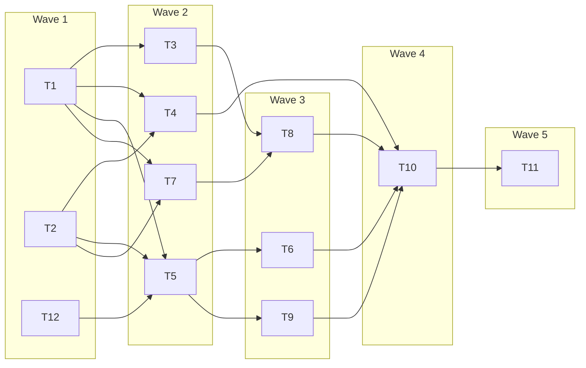

# Epic — metric-computation (F1)

> **PRD:** [PRD.md](../PRD.md) · **Design:** [sad.md](../sad.md) · **Data model:** [data-model.md](../data-model.md) · **Contract:** [cli.md](../contracts/cli.md) ([report](../contracts/api-sync-report.md)) · **Test plan:** [test-plan.md](../test-plan.md) · **Domain:** [CONTEXT.md](../CONTEXT.md) · **ADRs:** [adr/](../adr/)

## Goal

A Lead gets a team's cycle time for a closed month from the command line, traced to its definition version,
state map and inputs, or a plain refusal; never a zero, never a value per person (PRD §2).

## Scope

- **In:** `shared`, `platform`, Collection, Definitions, Computation, `entrypoints/cli.py` (surface `cli`, F1 ADR 0001). Migrations 0002 and 0003 are already live, so there is no migration task.
- **Out:** PRD §3 non-goals: a second metric, all teams in one run, drill-down, Evidence Guard verdicts, the monthly page, any per-person output, the API and web app.

## Task map

Waves are columns; arrows are `deps` (the same DAG as [tasks.json](./tasks.json)).

## Tasks

See [tracker.md](./tracker.md) for status. Machine contract: [tasks.json](./tasks.json).

| # | Task | Layer | Blocked by | DoD (first item) |
|---|---|---|---|---|
| T1 | Add shared Team, Period, Refusal codes, records and event types | domain | — | unit tests: `Period.is_closed` is false at the last second of the month and true at the fi |
| T2 | Add platform config and one-transaction database helper | infra | — | integration test: a transition for a missing snapshot is rejected (foreign keys on) |
| T12 | Close the contract deferrals and the SAD doc debt | docs | — | `api-sync-report.md` Deferrals 1-3 are closed or carry an owner decision |
| T3 | Implement passes, median and cycle-time outcome in computation domain | domain | T1 | unit tests for every AC-01, AC-01b, AC-04, AC-08 row of the [test plan](../test-plan.md) p |
| T4 | Read definitions file: versions, retirement, state maps, hashes | app | T1, T2 | integration test with a temporary file: absent file → `definitions_missing`, retired v1 →  |
| T5 | Import a snapshot file into immutable collection tables | app | T1, T2, T12 | integration test: person fields in the file never reach a table |
| T7 | Store measurements and state maps by measurement key | infra | T1, T2 | integration test on a migrated temporary database: find by key, insert, second insert of t |
| T6 | Serve the latest snapshot for a team and period | infra | T5 | integration test: none → `snapshot_missing`; another team's snapshot is not returned; two  |
| T8 | Compute use case: coverage, key lookup, match or defect, record | app | T3, T7 | integration tests: match records nothing; defect records nothing and returns no value; unm |
| T9 | Add the import command and the in-process event dispatcher | ports | T5 | e2e in process: new, identical and invalid files give the contract's replies and exit code |
| T10 | Add the compute command with ordered checks and replies | ports | T4, T6, T8, T9 | e2e in process for every AC-01..AC-10 row of the [test plan](../test-plan.md) marked e2e |
| T11 | Add the NFR suite: all-or-nothing, person scan, offline, run time, smoke | tests | T10 | all five suites pass in `make check` |

Lanes `implement-tasks` will serialize by overlapping `files_hint`: T5 → T6 (`collection/`), T9 → T10 (`cli.py`).

## Risks / Hard rules

- Team-level only: no task adds an output, column, log line or fixture per person (PRD §6.1, AGENTS.md).
- All-or-nothing: every check before the first write (F1 ADR 0002); T11 proves it for every refusal.
- Synthetic data only in fixtures; the private definitions file is never read by a test.
- Computation `domain` imports only the standard library and `shared`.
- Open: KPI 3 (share of runs refused for unmapped states) has no data in F1, because a refusal records
  nothing; measuring it is deferred to a later feature (owner decision 2026-11-24, SAD §11).
